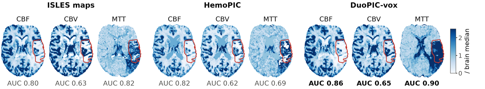
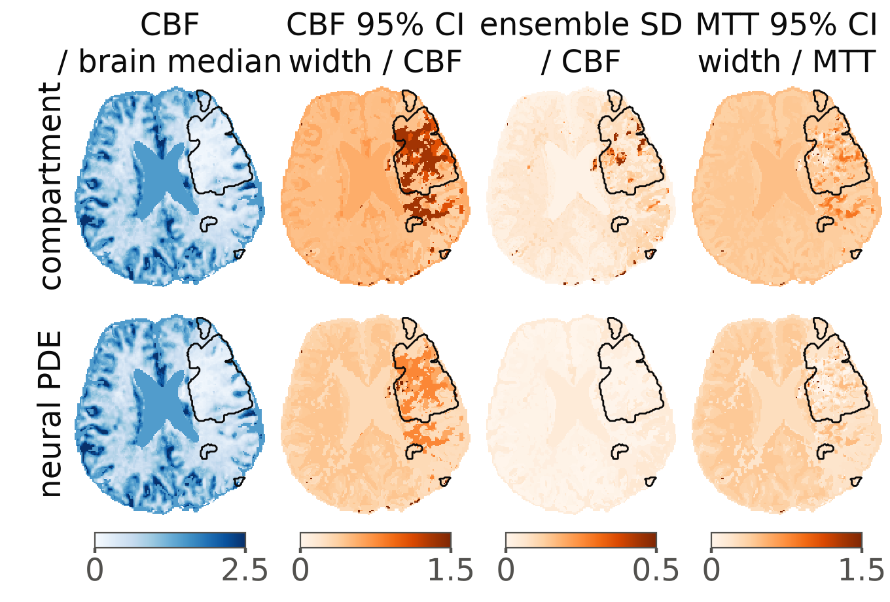

# DuoPIC

Code of **DuoPIC: uncertainty-aware voxel-level digital twins of cerebral perfusion with transport PDEs in acute stroke** (ISBI 2027 submission).

DuoPIC is a patient-specific perfusion digital twin. For every region of interest (ROI) it fits a Windkessel flow model and a transport tissue model with a neural closure shared across patients to the tracer curve, without reference deconvolution maps, and maps the parameters and their uncertainty to voxel CBF, CBV and MTT. A voxel-level fit, DuoPIC-vox, needs no tuning. DuoPIC builds on [HemoPIC](https://github.com/jhuldr/HemoPIC) (MICCAI 2026); the Python package keeps its working name, `hemopic_plus`.

## Main results

ISLES 2017, 43 patients (Zenodo release). Lesion metrics are computed on maps divided by their brain median; the lesion comparisons use the 36 patients with an accepted automatic AIF.

**Tissue models** (Table 1; neural PDE on held-out patients, 5-fold cross-validation by patient)

| | Compartment | PDE | Neural PDE |
|---|---|---|---|
| nRMSE, brain / lesion | 0.116 / 0.271 | 0.108 / 0.277 | **0.094 / 0.265** |
| Semi-synthetic coverage of the 95% interval, CBF / MTT / τ (%) | 97.0 / 88.1 / 70.3 | – | 98.2 / **93.8 / 78.4** |
| Width (median 95% interval / value), CBF / MTT (%) | 85 / 94 | – | **72 / 71** |
| MTT median absolute relative error (%) | 15.7 | – | **8.9** |
| Hidden frames: 95% coverage (%) | 84.0 | – | 84.8 |
| Hidden frames: squared error / curve energy (median per ROI) | 0.338 | 0.333 | **0.197** |
| ROIs with a lower AIC than the compartment (%) | – | 27 | **64** |

**Lesion detection** (Table 2; mean AUC and AP over CBF, CBV and MTT)

| Method | CBF | CBV | MTT | Mean | AP |
|---|---|---|---|---|---|
| ISLES maps | 0.745 | 0.584 | 0.700 | 0.676 | 0.085 |
| HemoPIC | 0.773 | 0.592 | 0.722 | 0.696 | 0.104 |
| oSVD, same AIF | 0.782 | **0.623** | 0.759 | 0.721 | 0.109 |
| DuoPIC, compartment | 0.790 | 0.552 | 0.766 | 0.703 | 0.113 |
| DuoPIC, PDE | 0.787 | 0.555 | 0.774 | 0.705 | 0.113 |
| DuoPIC, neural PDE | 0.788 | 0.561 | 0.768 | 0.706 | 0.113 |
| DuoPIC, ID-CBV | 0.807 | **0.623** | 0.745 | 0.725 | 0.114 |
| **DuoPIC-vox** | **0.810** | **0.623** | **0.801** | **0.745** | **0.120** |

- DuoPIC-vox raises the mean AUC over oSVD with the same AIF by 0.023 (95% bootstrap CI [0.011, 0.035]) and over HemoPIC in 31 of 36 patients.
- **External test**, 145 ISLES'24 CT perfusion patients with all settings fixed on ISLES 2017: mean AUC 0.743 for DuoPIC-vox, against 0.691 (oSVD), 0.688 (HemoPIC) and 0.687 (vendor maps); AP 0.120 against 0.104 (HemoPIC) and 0.088 (vendor).
- In normal grey matter the neural PDE gives a median CBF of 52 ml/100 g/min, CBV of 4.2 ml/100 g and MTT of 4.9 s (HemoPIC: 22, 1.4 and 4.6).
- Run time per patient on one CPU thread: about 10 s for the regional fit and 100 s for the voxel fit (about 2·10⁵ voxels).





## Paper and code

| Paper | Code | Commands | Results |
|---|---|---|---|
| Sec. 2.1–2.2, regional model (changes C1–C9 below) | `hemopic_plus/`, `configs/` | `scripts/run_cohort.py`, `scripts/evaluate.py` | `docs/RESULTS.md` |
| Sec. 2.3, uncertainty | `hemopic_plus/uq/` | `run_uq.py`, `eval_heldout.py`, `eval_semisynth.py`, `eval_uq.py`, `run_ensemble.py`, `run_aif_ensemble.py` | `docs/UNCERTAINTY.md`, `docs/results/full_aif/uq/` |
| Sec. 2.4, transport PDE and neural closure | `hemopic_plus/npde/transport.py`, `neural.py`, `uqbatch.py` | `run_pde.py`, `train_npde.py`, `run_npde_uq.py` | `docs/NEURAL_PDE.md`, `docs/results/full_aif/npde/` |
| Sec. 2.5, DuoPIC-vox | `hemopic_plus/npde/voxel.py` | `run_voxel_pde.py`, `eval_voxel_maps.py`, `run_voxel_uq.py` | `docs/results/vox_pde/`, `docs/results/full_aif/vox_uq/` |
| Table 1, hidden frames and AIC | | `eval_hidden_frames.py`, `eval_model_selection.py` | `docs/results/full_aif/npde/eval/` |
| Table 2, oSVD with the same AIF | `hemopic_plus/osvd.py` | `osvd_check.py`, `eval_voxel_maps.py` | `docs/results/osvd/`, `docs/results/vox_pde/` |
| AP, Dice, bootstrap intervals, physiology | `hemopic_plus/lesion_metrics.py` | `eval_lesion_metrics.py` | `docs/results/full_aif/lesion_metrics/` |
| External test, ISLES'24 | | `prepare_isles24.py`, `smooth_external.py`, `eval_external.py --metrics`, `osvd_grid_ct.py` | `docs/results/isles24/` |
| Run time | | `time_pipeline.py` | `docs/results/timing/pipeline_timing.json` |
| Fig. 2, residuals around the bolus peak | | `make_npde_figures.py --configs full_aif` | |
| Fig. 3, uncertainty maps | | `make_uq_figures.py` (`fig_maps_column`, see below) | `docs/figures/duopic_uq_maps_column.png` |
| Fig. 4, lesion maps of one patient | | `make_hemopic_comparison.py --wide` | `docs/figures/hemopic_vs_duopic_maps_wide.png` |

All commands are in `scripts/`; each script states its full usage in its docstring.

Additional analyses that are not in the paper: a stochastic transport PDE with inlet noise (`hemopic_plus/npde/stochastic.py`, `run_spde.py`, `docs/results/full_aif/spde/`), a data-driven Fourier neural operator baseline (`train_operator.py`) and a neural-operator surrogate of the exact PDE solver (`bench_operator_solver.py`), both in `docs/results/full_aif/operator/`.

## Changes to HemoPIC

Each change is switched on or off from a config file. The `baseline` config reproduces the original HemoPIC exactly, and `tests/test_baseline_equivalence.py` checks this.

- **C1** Each subject's true repetition time instead of a fixed 1 s.
- **C5** Consistent flow units in the tracer compartment (exchange rate q/(60 V) per second).
- **C2** Per-ROI bolus delay and dispersion of the arterial input.
- **C3** Reference-free mode: no deconvolution map is read for priors, textures or bounds.
- **C4** Random restarts of poor fits.
- **C6** Automatic arterial input function with partial-volume correction from the venous output function.
- **C7** Windkessel started at steady state (tested, not used).
- **C8** CBV by indicator dilution (`cbv_source: id_regional | id_voxel`).
- **C9** Voxel CBF texture consistent with the voxel CBV (`cbf_texture: osvd | moment`).

Configurations used in the paper: `full_aif` (DuoPIC with the compartment), `full_aif` with `run_pde.py` / `train_npde.py` (PDE, neural PDE), `full_aif_idvox_osvd_nc` (ID-CBV), and the voxel fit `full_aif__vox_tank` combined with the ID-CBV CBV (DuoPIC-vox). The `isles24_*` configs are the same settings for the external test.

## Installation

Clone this repository next to the original HemoPIC repository: the default configs read the data from `../HemoPIC/data/ISLES2017_Training`, and the baseline test uses the demo bundled with HemoPIC.

```bash
python -m venv .venv
source .venv/bin/activate          # Windows: .venv\Scripts\activate
pip install -r requirements.txt    # PyTorch (CPU is enough), Optuna, SimpleITK, pyarrow, ...
python tests/test_baseline_equivalence.py
```

Tests: `tests/test_baseline_equivalence.py`, `test_uq_torch.py`, `test_npde.py`, `test_voxel.py`; each prints `all tests passed`.

## Data

**ISLES 2017.** With preprocessed data (`../HemoPIC/data/ISLES2017_Training`, 43 subjects with `CTC_from_MR_4DPWI.nii` and `hemopic_seg4/`) nothing else is needed. From scratch:

```bash
python preprocess/prepare_isles2017.py <data_dir>                   # needs FreeSurfer >= 7.3 for SynthSeg
python preprocess/prepare_isles2017.py <data_dir> --skip-synthseg   # without FreeSurfer
```

then set `data_root` in the configs or pass `--data-root`. The Zenodo release has 43 subjects (training_1..48 without 3, 17, 25, 29 and 34).

**ISLES'24.** The training set (149 subjects, CC BY-NC-SA) is prepared in the ISLES 2017 layout: rigid registration of the CT perfusion to the non-contrast CT, SynthSeg tissue classes and concentration as the change from the baseline attenuation; the smoothed copy is used by every method.

```bash
python scripts/prepare_isles24.py <hf_dir> <ISLES2024_Training> --freesurfer <FREESURFER_HOME>
python scripts/smooth_external.py <ISLES2024_Training> <ISLES2024_Training_s3> --sigma 3
```

## Reproducing the paper

```bash
# regional fits (HemoPIC, DuoPIC, ID-CBV) and the oSVD reference
python scripts/run_cohort.py configs/baseline.yaml
python scripts/run_cohort.py configs/full_aif.yaml
python scripts/run_cohort.py configs/full_aif_idvox_osvd_nc.yaml
python scripts/osvd_check.py configs/full_aif.yaml --compare baseline full_aif

# uncertainty of the compartment model
python scripts/run_uq.py configs/full_aif.yaml
python scripts/eval_heldout.py configs/full_aif.yaml
python scripts/eval_semisynth.py configs/full_aif.yaml
python scripts/eval_uq.py configs/full_aif.yaml
python scripts/run_ensemble.py configs/full_aif.yaml

# transport PDE, neural PDE and their uncertainty
python scripts/run_pde.py configs/full_aif.yaml
python scripts/train_npde.py configs/full_aif.yaml --extra-members 3
python scripts/run_npde_uq.py configs/full_aif.yaml
python scripts/eval_hidden_frames.py configs/full_aif.yaml
python scripts/eval_model_selection.py configs/full_aif.yaml

# DuoPIC-vox and the lesion metrics
python scripts/run_voxel_pde.py configs/full_aif.yaml
python scripts/eval_voxel_maps.py configs/full_aif.yaml
python scripts/eval_lesion_metrics.py configs/full_aif.yaml

# external test (ISLES'24)
for c in isles24_baseline isles24_full_aif isles24_full_aif_idvox_osvd_nc; do
  python scripts/run_cohort.py configs/$c.yaml --data-root <ISLES2024_Training_s3> --out-root outputs_s3
done
python scripts/eval_external.py --data-root <ISLES2024_Training_s3> --out-root outputs_s3 --metrics
```

Figures 3 and 4 as printed in the paper:

```python
import sys; sys.path.insert(0, "scripts")
from pathlib import Path
import make_uq_figures as M
M.PREFIX = "duopic_uq_"
M.fig_maps_column(Path("outputs"), "../HemoPIC/data/ISLES2017_Training", ["full_aif", "full_aif__npde"], pid=22,
                  width=3.4, fs=7, labels={"full_aif": "compartment", "full_aif__npde": "neural PDE"},
                  titles=["CBF\n/ brain median", "CBF 95% CI\nwidth / CBF", "CBF ensemble\nSD / CBF", "MTT 95% CI\nwidth / MTT"])
```

```bash
python scripts/make_hemopic_comparison.py --patient 13 --wide
```

The outputs keep HemoPIC's file layout (`HemoPIC_CBF/CBV/MTT.nii.gz`, `roi_fit_summary.csv`, ...), so the `Eval/` scripts of the original repository run on them unchanged. For the tracer nRMSE use `scripts/evaluate.py`: the original tracer script rebuilds the curves with the original model.

## Repository layout

```
configs/         one file per experiment; isles2017_tr.json holds the true TR per subject (C1)
preprocess/      ISLES 2017: download, flatten, TR, signal to concentration, SynthSeg tissue classes
hemopic_plus/    library
  config.py io.py signal.py models.py fit.py pipeline.py evaluation.py aif.py osvd.py lesion_metrics.py
  uq/            differentiable model, Laplace, MCMC
  npde/          transport PDE (exact modal solver), neural closure, voxel fit, stochastic PDE
scripts/         fitting, uncertainty, PDE, evaluation, external test and figures (usage in each docstring)
tests/           baseline equivalence with HemoPIC; checks of the torch model, the PDE and the voxel fit
docs/            RESULTS.md, UNCERTAINTY.md, NEURAL_PDE.md, PLAN.md (in Vietnamese), figures/, results/
```

## Configuration

Every key is defined in `hemopic_plus/config.py`, and the defaults are the original behaviour. A config lists only the keys that differ:

```yaml
name: my_experiment
data: {data_root: ../HemoPIC/data/ISLES2017_Training, out_root: outputs}
time: {dt_source: tr_table}
model: {flow_per_minute: true, delay_dispersion: true, delay_bounds: [-4, 10]}
robust: {multistart: 4}
reference_free: {prior_source: tracer, cbv_texture: tracer_auc, map_bounds: fixed}
partition: {k_gm: 16, k_wm: 12}
```

## License

Code copied and adapted from HemoPIC (MIT, © 2026 LDR Group @ JHU) is marked "(HemoPIC)" in the source; see `LICENSE_HemoPIC`.
