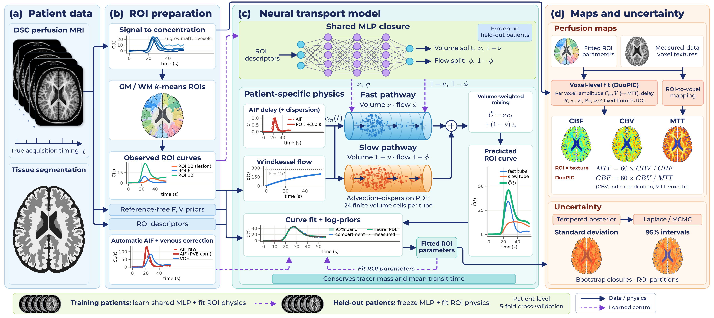
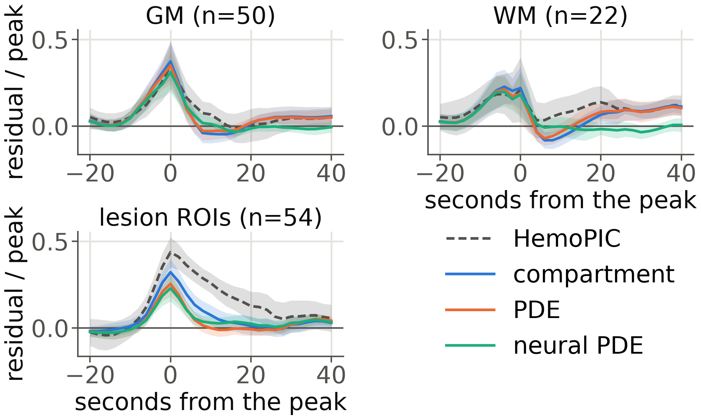

# DuoPIC: Uncertainty-Aware Voxel-Level Digital Twins of Cerebral Perfusion with Transport PDEs in Acute Stroke

Anh Duong Tran\*, Quang-Anh N. D.\*, Toan Sy Pham, Trang H. Hoang, Minh N. Do, Yiuno Chen, Duy Ton Mai, Huan X. Nguyen
(\* equal contribution)

London Digital Twin Research Centre, Middlesex University · Bach Mai Stroke Centre, Bach Mai Hospital · Hanoi Medical University · Vietnam National University · University of Illinois Urbana-Champaign · VinUniversity · University of Alberta · Imperial College London

Submitted to the IEEE International Symposium on Biomedical Imaging (ISBI) 2027.



*Fig. 1. Overview of DuoPIC. (a) Input data. (b) ROI preparation with reference-free priors and an automatic AIF. (c) Neural transport model, in which Windkessel flow and a delayed, dispersed input drive a fast and a slow tube split by a shared network that conserves tracer mass and MTT. (d) Voxel maps (ROI level × texture, or voxel fit) and their uncertainty.*

## Abstract

Digital twins of cerebral perfusion relate tracer dynamics to cerebral blood flow (CBF), blood volume (CBV) and mean transit time (MTT), but must be data-driven, physically consistent and uncertainty-aware. We introduce DuoPIC, a digital twin that needs no reference maps, in which a Windkessel flow model drives a tracer transport partial differential equation (PDE). A population-level neural closure divides each region into fast and slow pathways with tracer mass and MTT conserved by construction, and a tempered posterior quantifies the uncertainty of every estimate. Its voxel maps set the state of the art for lesion detection on ISLES'17 MR (AUC 0.745) and ISLES'24 CT (0.743). On held-out patients, the neural PDE reduced the compartment's reconstruction error by 19% and lifted 95% MTT interval coverage from 88% to 94%.

## 1. Introduction

Clinical perfusion analysis deconvolves each tissue curve with an arterial input function (AIF) by truncated or block-circulant singular value decomposition, a model-free approach sensitive to noise and to the AIF. [HemoPIC](https://github.com/jhuldr/HemoPIC) (Lee and Liu, MICCAI 2026) brought digital twins to brain perfusion by personalising flow and tracer models for every scan region, but with inconsistent units, priors taken from reference deconvolution maps, a well-mixed compartment that cannot represent capillary transit-time heterogeneity, and no uncertainty. DuoPIC addresses these limitations:

1. a **reference-free, uncertainty-aware perfusion digital twin** that couples patient-specific haemodynamics with transport physics from region to voxel level;
2. a **physics-preserving neural closure**, shared across patients, that learns transit-time heterogeneity while provably conserving tracer mass, CBF, CBV and MTT;
3. **voxel maps with state-of-the-art lesion detection** on ISLES'17 MR and 145 ISLES'24 CT perfusion patients.

The Python package keeps its working name, `hemopic_plus`.

## 2. Proposed DuoPIC

DuoPIC estimates voxel CBF, CBV and MTT with posterior SD and 95% intervals from the tracer concentration, without reference maps or lesion labels. As in HemoPIC, k-means clusters grey- and white-matter voxels by curve features and position into regions of interest (ROIs), whose parameters minimise a normalised weighted squared error plus log-space priors.

| Section | What | Code |
|---|---|---|
| 2.1 Reference-free regional model | true repetition time; consistent flow units, k = q/(60V); exact per-frame integration; automatic AIF with venous partial-volume correction; per-ROI bolus delay and dispersion; indicator-dilution and maximum-slope priors; voxel indicator-dilution CBV (ID-CBV); restarts of poor fits | `hemopic_plus/` (`models.py`, `fit.py`, `aif.py`, `pipeline.py`), `configs/full_aif.yaml` |
| 2.2 Transport PDE and neural closure | tube with plug flow and dispersion (Péclet number), Danckwerts inlet, 24 finite volumes solved exactly from one eigendecomposition per ROI; two parallel tubes split by an MLP (9→32→32→2) shared across patients, trained in patient-level 5-fold cross-validation; Proposition 1 (conservation and map invariance) | `hemopic_plus/npde/transport.py`, `neural.py` |
| 2.3 Voxel-level fit | every voxel fits (ln V, ln C_in, delay) with priors around its ROI; batched Levenberg-Marquardt, about 2·10⁵ voxels in about 100 s on one CPU thread; CBF = 60 CBV / MTT with ID-CBV | `hemopic_plus/npde/voxel.py` |
| 2.4 Uncertainty quantification | tempered posterior; random-walk Metropolis preconditioned by a Laplace approximation for ROI and PDE parameters; voxel Laplace with the ROI part passed down by the implicit function theorem; bootstrap networks and pipeline ensemble | `hemopic_plus/uq/`, `hemopic_plus/npde/uqbatch.py` |

### Changes to HemoPIC

Each change is switched on or off from a config file. The `baseline` config reproduces the original HemoPIC exactly, which `tests/test_baseline_equivalence.py` checks.

- **C1** Each subject's true repetition time instead of a fixed 1 s.
- **C2** Per-ROI bolus delay and dispersion of the arterial input.
- **C3** Reference-free mode: no deconvolution map is read for priors, textures or bounds.
- **C4** Random restarts of poor fits.
- **C5** Consistent flow units in the tracer compartment (exchange rate q/(60 V) per second).
- **C6** Automatic arterial input function with partial-volume correction from the venous output function.
- **C7** Windkessel started at steady state (tested, not used).
- **C8** CBV by indicator dilution (`cbv_source: id_regional | id_voxel`).
- **C9** Voxel CBF texture consistent with the voxel CBV (`cbf_texture: osvd | moment`).

## 3. Experimental setup

**Data.** The 43 ISLES'17 subjects (Zenodo release) with DSC perfusion and final infarct masks, preprocessed as in HemoPIC with four SynthSeg tissue classes. External test: the 149 ISLES'24 training subjects with CT perfusion and follow-up MRI masks (145 with the infarct in view), registered to the non-contrast CT, baseline-subtracted and smoothed in plane (3-voxel Gaussian) for all methods. ISLES'17 lesion detection uses the 36 subjects whose automatic AIF is earlier, narrower and higher than the tissue mean.

**Metrics.** nRMSE of the tracer reconstruction; lesion ROC AUC and average precision (AP) of CBF (low), CBV (low) and MTT (high) relative to the brain median, with paired Wilcoxon tests and patient-level bootstrap intervals; Akaike information criterion (AIC) of the tissue models.

**Implementation.** The closure is trained with Adam and a cosine schedule for 1500 steps (learning rates 2·10⁻² physics, 2·10⁻³ network); held-out patients are refitted for 1000 steps; the posterior runs four chains of 6000 steps after 3000 burn-in, keeping every fourth (1500 draws per chain).

## 4. Results

**Table 1.** Held-out diagnostics (ISLES'17). Parameter coverage: semi-synthetic; width: median 95% interval / value; nMSE: hidden-frame error, ROI median; –: not evaluated.

| Metric | Compartment | PDE | Neural PDE |
|---|---|---|---|
| Brain nRMSE ↓ | 0.116 | 0.108 | **0.094** |
| Lesion nRMSE ↓ | 0.271 | 0.277 | **0.265** |
| CBF coverage (%) →95 | 97.0 | – | 98.2 |
| MTT coverage (%) →95 | 88.1 | – | **93.8** |
| τ coverage (%) →95 | 70.3 | – | **78.4** |
| CBF width (%) ↓ | 85 | – | **72** |
| MTT width (%) ↓ | 94 | – | **71** |
| MTT median \|rel. err.\| (%) ↓ | 15.7 | – | **8.9** |
| Hidden 95% coverage (%) →95 | 84.0 | – | **84.8** |
| Hidden nMSE ↓ | 0.338 | 0.333 | **0.197** |
| AIC below compartment (%) ↑ | – | 27 | **64** |

**Table 2.** Lesion AUC, 36 ISLES'17 patients with an accepted AIF. Mean: map-averaged AUC; AP: average precision.

| Method | CBF | CBV | MTT | Mean | AP |
|---|---|---|---|---|---|
| ISLES maps | 0.745 | 0.584 | 0.700 | 0.676 | 0.085 |
| HemoPIC | 0.773 | 0.592 | 0.722 | 0.696 | 0.104 |
| oSVD (same AIF) | 0.782 | **0.623** | 0.759 | 0.721 | 0.109 |
| DuoPIC, compartment | 0.790 | 0.552 | 0.766 | 0.703 | 0.113 |
| DuoPIC, PDE | 0.787 | 0.555 | 0.774 | 0.705 | 0.113 |
| DuoPIC, neural PDE | 0.788 | 0.561 | 0.768 | 0.706 | 0.113 |
| DuoPIC, ID-CBV | 0.807 | **0.623** | 0.745 | 0.725 | 0.114 |
| **DuoPIC** (voxel fit) | **0.810** | **0.623** | **0.801** | **0.745** | **0.120** |

- **Model fit and physiology.** In about 90% of HemoPIC's ROIs the posterior SD of F and V equals the prior SD; with consistent units the data constrain both in over 90%. The compartment still misses 22–37% of the signal at the bolus peak (HemoPIC 21–44%, Fig. 2). On hidden frames the neural PDE predicts the curve better than the compartment in 65% of the ROIs (a single tube in 36%). In normal grey matter it gives a median CBF of 52 ml/100 g/min, CBV of 4.2 ml/100 g and MTT of 4.9 s (HemoPIC 22, 1.4 and 4.6).
- **Uncertainty.** The neural PDE brings the MTT and τ intervals closer to 95% and narrows the median 95% CBF interval from 116% of the value (HemoPIC) to 72%; its network uncertainty (0.6% of CBF) is small next to the posterior one (16.9%). Removing the most uncertain voxels (Fig. 3) raises the lesion AUC of MTT from 0.755 to 0.787.
- **Lesion detection.** Without any tuning, DuoPIC has the best mean AUC, 0.023 above oSVD with the same AIF (95% CI [0.011, 0.035]), and the best MTT map (+0.042, p = 0.002); it improves every map over HemoPIC (p < 0.001) and the mean AUC in 31 of 36 patients (Fig. 4). On 145 ISLES'24 CT patients it reaches a mean AUC of 0.743 (best oSVD setting 0.691, HemoPIC 0.688, vendor maps 0.687, p < 10⁻²⁰ each) and an AP of 0.120 (HemoPIC 0.104, vendor maps 0.088).



*Fig. 2. Mean residual (measured − fitted, relative to the peak) around the bolus peak, ±2 standard errors, for HemoPIC and DuoPIC; GM, WM: lesion-free ROIs; lesion: ROIs over 20% infarcted; n: number of ROIs.*


*Fig. 3. Uncertainty maps for the compartment (top) and the neural PDE (bottom), with the final infarct in black. CBF is divided by its brain median and the others by the estimate.*


*Fig. 4. CBF, CBV and MTT of one ISLES'17 patient relative to the brain median, with the final infarct in red, from the ISLES maps, HemoPIC and DuoPIC, with the lesion AUC of each map (best in bold).*

## 5. Conclusion

DuoPIC makes a perfusion digital twin reference-free and uncertainty-aware. Its neural transport PDE better predicts unseen frames with physical CBF, CBV and MTT, and its tuning-free voxel fit achieves state-of-the-art lesion AUC and AP. Absolute values still depend on the automatic AIF, and the reference infarct also reflects treatment.

## Reproducing the paper

### Installation

Clone this repository next to the original HemoPIC repository: the default configs read the data from `../HemoPIC/data/ISLES2017_Training`, and the baseline test uses the demo bundled with HemoPIC.

```bash
python -m venv .venv
source .venv/bin/activate          # Windows: .venv\Scripts\activate
pip install -r requirements.txt    # PyTorch (CPU is enough), Optuna, SimpleITK, pyarrow, ...
python tests/test_baseline_equivalence.py
```

Tests: `tests/test_baseline_equivalence.py`, `test_uq_torch.py`, `test_npde.py`, `test_voxel.py`; each prints `all tests passed`.

### Data

**ISLES'17.** With preprocessed data (`../HemoPIC/data/ISLES2017_Training`, 43 subjects with `CTC_from_MR_4DPWI.nii` and `hemopic_seg4/`) nothing else is needed. From scratch:

```bash
python preprocess/prepare_isles2017.py <data_dir>                   # needs FreeSurfer >= 7.3 for SynthSeg
python preprocess/prepare_isles2017.py <data_dir> --skip-synthseg   # without FreeSurfer
```

then set `data_root` in the configs or pass `--data-root`. The Zenodo release has 43 subjects (training_1..48 without 3, 17, 25, 29 and 34).

**ISLES'24.** The training set (149 subjects, Hugging Face mirror `hugging-science/isles24-stroke`, CC BY-NC-SA 4.0) is prepared in the ISLES'17 layout: rigid registration of the CT perfusion to the non-contrast CT, SynthSeg tissue classes and concentration as the change from the baseline attenuation; the smoothed copy is used by every method.

```bash
python scripts/prepare_isles24.py <hf_dir> <ISLES2024_Training> --freesurfer <FREESURFER_HOME>
python scripts/smooth_external.py <ISLES2024_Training> <ISLES2024_Training_s3> --sigma 3
```

### Commands

```bash
# Sec. 2.1, Table 2: regional fits (HemoPIC, DuoPIC, ID-CBV) and oSVD with the same AIF
python scripts/run_cohort.py configs/baseline.yaml
python scripts/run_cohort.py configs/full_aif.yaml
python scripts/run_cohort.py configs/full_aif_idvox_osvd_nc.yaml
python scripts/osvd_check.py configs/full_aif.yaml --compare baseline full_aif

# Sec. 2.4, Table 1: uncertainty of the compartment model
python scripts/run_uq.py configs/full_aif.yaml
python scripts/eval_heldout.py configs/full_aif.yaml
python scripts/eval_semisynth.py configs/full_aif.yaml
python scripts/eval_uq.py configs/full_aif.yaml
python scripts/run_ensemble.py configs/full_aif.yaml

# Sec. 2.2, Table 1: transport PDE, neural PDE and their uncertainty
python scripts/run_pde.py configs/full_aif.yaml
python scripts/train_npde.py configs/full_aif.yaml --extra-members 3
python scripts/run_npde_uq.py configs/full_aif.yaml
python scripts/eval_hidden_frames.py configs/full_aif.yaml              # add --models compartment for the compartment only
python scripts/eval_model_selection.py configs/full_aif.yaml

# Sec. 2.3, Table 2: voxel fit and lesion metrics
python scripts/run_voxel_pde.py configs/full_aif.yaml
python scripts/eval_voxel_maps.py configs/full_aif.yaml
python scripts/eval_lesion_metrics.py configs/full_aif.yaml

# Sec. 4: external test (ISLES'24)
for c in isles24_baseline isles24_full_aif isles24_full_aif_idvox_osvd_nc; do
  python scripts/run_cohort.py configs/$c.yaml --data-root <ISLES2024_Training_s3> --out-root outputs_s3
done
python scripts/eval_external.py --data-root <ISLES2024_Training_s3> --out-root outputs_s3 --metrics
python scripts/osvd_grid_ct.py --data-root <ISLES2024_Training_s3> --out-root outputs_s3
```

| Paper item | Script | Results in the repository |
|---|---|---|
| Fig. 1, panels of the overview | `make_overview_panels.py configs/full_aif.yaml --patient 22` | |
| Fig. 2, residuals around the bolus peak | `make_npde_figures.py` (`fig_residuals_column`) | `docs/figures/duopic_residuals_column.png` |
| Fig. 3, uncertainty maps | `make_uq_figures.py` (`fig_maps_column`, below) | `docs/figures/duopic_uq_maps_column.png` |
| Fig. 4, lesion maps of one patient | `make_hemopic_comparison.py --patient 13 --wide` | `docs/figures/hemopic_vs_duopic_maps_wide.png` |
| Table 1 | `eval_heldout.py`, `eval_semisynth.py`, `eval_hidden_frames.py`, `eval_model_selection.py` | `docs/results/full_aif/uq/`, `docs/results/full_aif/npde/` |
| Table 2, AP and bootstrap intervals | `eval_voxel_maps.py`, `eval_lesion_metrics.py` | `docs/results/vox_pde/`, `docs/results/full_aif/lesion_metrics/` |
| External test | `eval_external.py --metrics`, `osvd_grid_ct.py` | `docs/results/isles24/` |
| Run time | `time_pipeline.py` | `docs/results/timing/pipeline_timing.json` |

```python
# Figs. 2 and 3 as printed
import sys; sys.path.insert(0, "scripts")
from pathlib import Path
import make_npde_figures as N, make_uq_figures as M
N.fig_residuals_column(Path("outputs"), Path("../HemoPIC/data/ISLES2017_Training"), grid=True)
M.PREFIX = "duopic_uq_"
M.fig_maps_column(Path("outputs"), "../HemoPIC/data/ISLES2017_Training", ["full_aif", "full_aif__npde"], pid=22,
                  width=3.4, fs=7, labels={"full_aif": "compartment", "full_aif__npde": "neural PDE"},
                  titles=["CBF\n/ brain median", "CBF 95% CI\nwidth / CBF", "CBF ensemble\nSD / CBF", "MTT 95% CI\nwidth / MTT"])
```

Every script states its full usage in its docstring. Configurations used in the paper: `full_aif` (compartment), `full_aif` with `run_pde.py` / `train_npde.py` (PDE, neural PDE), `full_aif_idvox_osvd_nc` (ID-CBV) and the voxel fit `full_aif__vox_tank` combined with the ID-CBV (DuoPIC); the `isles24_*` configs are the same settings for the external test. The outputs keep HemoPIC's file layout (`HemoPIC_CBF/CBV/MTT.nii.gz`, `roi_fit_summary.csv`, ...), so the `Eval/` scripts of the original repository run on them unchanged; for the tracer nRMSE use `scripts/evaluate.py`.

Additional analyses that are not in the paper: a stochastic transport PDE with inlet noise (`hemopic_plus/npde/stochastic.py`, `run_spde.py`), a Fourier neural operator baseline (`train_operator.py`) and a neural-operator surrogate of the exact PDE solver (`bench_operator_solver.py`).

### Repository layout

```
configs/         one file per experiment; isles2017_tr.json holds the true TR per subject (C1)
preprocess/      ISLES'17: download, flatten, TR, signal to concentration, SynthSeg tissue classes
hemopic_plus/    library
  config.py io.py signal.py models.py fit.py pipeline.py evaluation.py aif.py osvd.py lesion_metrics.py
  uq/            differentiable model, Laplace, MCMC
  npde/          transport PDE (exact modal solver), neural closure, voxel fit, stochastic PDE
scripts/         fitting, uncertainty, PDE, evaluation, external test and figures
tests/           baseline equivalence with HemoPIC; checks of the torch model, the PDE and the voxel fit
docs/            RESULTS.md, UNCERTAINTY.md, NEURAL_PDE.md, figures/, results/
```

### Configuration

Every key is defined in `hemopic_plus/config.py`, and the defaults are the original HemoPIC behaviour. A config lists only the keys that differ:

```yaml
name: my_experiment
data: {data_root: ../HemoPIC/data/ISLES2017_Training, out_root: outputs}
time: {dt_source: tr_table}
model: {flow_per_minute: true, delay_dispersion: true, delay_bounds: [-4, 10]}
robust: {multistart: 4}
reference_free: {prior_source: tracer, cbv_texture: tracer_auc, map_bounds: fixed}
partition: {k_gm: 16, k_wm: 12}
```

## Citation

```bibtex
@inproceedings{tran2027duopic,
  title     = {{DuoPIC}: Uncertainty-Aware Voxel-Level Digital Twins of Cerebral Perfusion with Transport {PDEs} in Acute Stroke},
  author    = {Tran, Anh Duong and N. D., Quang-Anh and Pham, Toan Sy and Hoang, Trang H. and Do, Minh N. and Chen, Yiuno and Mai, Duy Ton and Nguyen, Huan X.},
  booktitle = {IEEE International Symposium on Biomedical Imaging (ISBI)},
  year      = {2027},
  note      = {Submitted}
}
```

## Acknowledgments

Supported in part by the UK British Council ISPF programmes: the Early Career Fellowships (grant ID 1860), the International Research Collaborations with Vietnam (grant ID 1203701580), and the Going Global Partnerships 2025 under the Transnational Education (TNE) Exploratory Grants scheme (grant ID TNE2025-4829). This study used the open-access ISLES'17 and ISLES'24 data.

## License

Code copied and adapted from HemoPIC (MIT, © 2026 LDR Group @ JHU) is marked "(HemoPIC)" in the source; see `LICENSE_HemoPIC`.
