# HemoPIC+

An extension of [HemoPIC](https://github.com/jhuldr/HemoPIC) (MICCAI 2026), a physics-informed digital twin for cerebral perfusion. HemoPIC+ adds the changes C1–C9; each one is switched on or off from a config file. The `baseline` config reproduces the original HemoPIC **bit for bit**, and an automated test checks this.

- **C1** Use each subject's true repetition time (TR) instead of a fixed dt of 1 s.
- **C5** Make the flow units in the tracer compartment consistent (rate F/(60·V) per second).
- **C2** Model a per-ROI bolus delay and dispersion.
- **C3** Reference-free mode: no Deconv map is used for priors, textures or bounds.
- **C4** Robust fitting with random restarts (multistart).
- **C6** Automatic arterial input function (AIF) from arterial voxels, with partial-volume correction from the venous output function (VOF), giving priors in absolute units.
- **C7** Windkessel model started at steady state (tested; not recommended).
- **C8** CBV by indicator dilution (`cbv_source: id_regional` / `id_voxel`).
- **C9** Voxel CBF pattern consistent with the voxel CBV (`cbf_texture: osvd | moment`, `cbf_texture_clip: false`).

**Recommended configs:**
- `configs/full_aif_idvox_osvd_nc.yaml`: best average over CBF/CBV/MTT, and beats oSVD on CBF;
- `configs/full_idreg.yaml`: when MTT is the main map.

**Important caveat** (docs/RESULTS.md, section 2d): a standard oSVD deconvolution that uses the same automatic AIF and the true TR reaches lesion ROC AUCs on par with HemoPIC+ for CBF and MTT, and higher for CBV. Any comparison should use it as the baseline (`scripts/osvd_check.py`).

Rationale and design: [docs/PLAN.md](docs/PLAN.md). Full results: [docs/RESULTS.md](docs/RESULTS.md). Uncertainty: [docs/UNCERTAINTY.md](docs/UNCERTAINTY.md). PDE and neural PDE: [docs/NEURAL_PDE.md](docs/NEURAL_PDE.md). These documents are in Vietnamese.

## Main results

Data: 43 ISLES 2017 subjects (Zenodo release). Lesion ROC AUC is computed on relative maps (each map divided by its brain median), with the same formula as HemoPIC's `Eval/lesion_roc`.

### Lesion discrimination: a fair comparison with the same AIF

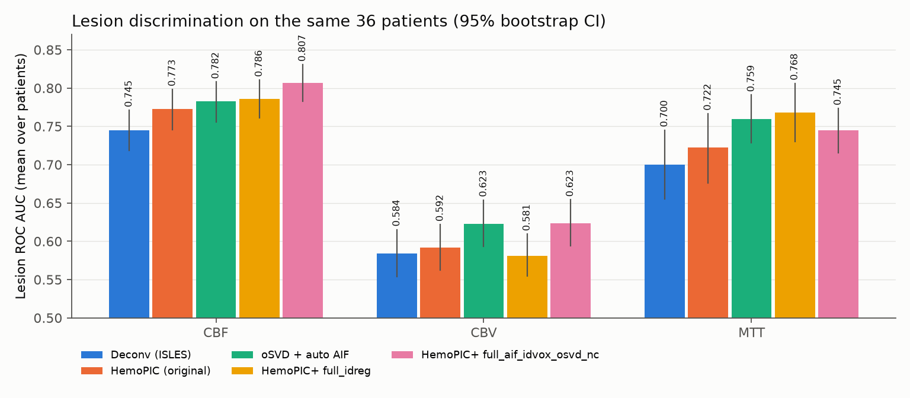

On the 36 subjects with an accepted automatic AIF:
- `full_aif_idvox_osvd_nc` beats oSVD on CBF (+0.024, p = 3e−4), ties on CBV, and is slightly lower on MTT (−0.014, p = 0.03);
- `full_idreg` is best on MTT;
- the ISLES Deconv maps are lowest on all three maps.

Most of the gap between HemoPIC and the ISLES Deconv maps comes from processing (AIF selection, TR), not from the physical model: oSVD with the automatic AIF already closes most of it.

### Cumulative ablation

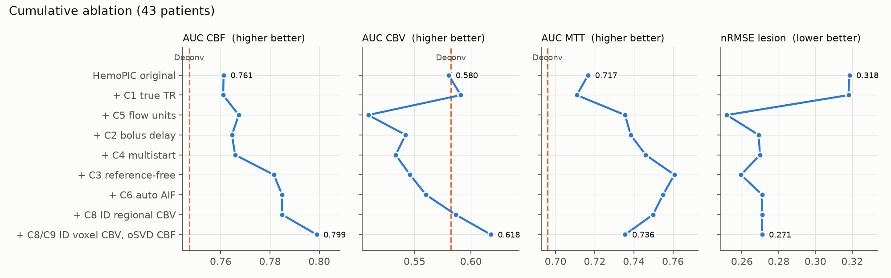

### Diagnosis: the original HemoPIC keeps F and V at their priors, which come from the Deconv maps

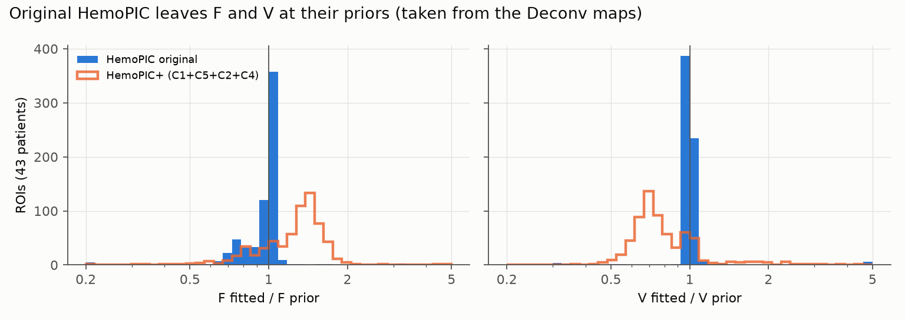

The original tracer compartment applies the exchange rate F/V per second, while F comes from CBF in ml/100g/min (a unit mismatch, fixed by C5). As a result, the data cannot constrain F and V, and the fitted values stay at the priors (ratio ≈ 1). After the fix, the model actually learns from the curves.

### Tracer curve reconstruction (compare with Fig. 5b of the paper)

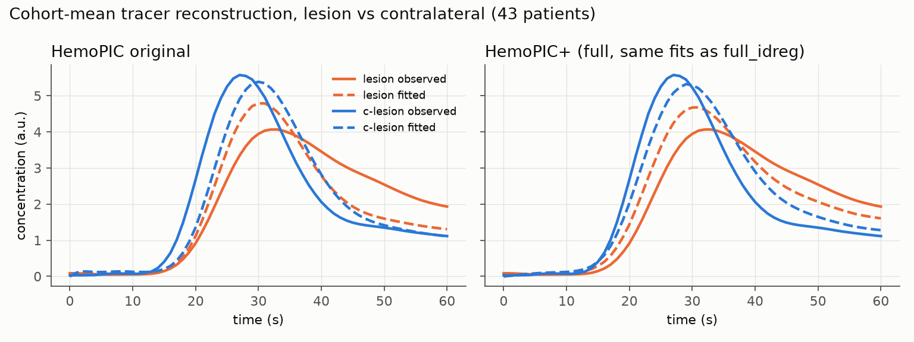

The lesion nRMSE drops from 0.318 to 0.260 (p = 8e−12); the long tail of the lesion curve is captured better.

### Example maps (subject 22)

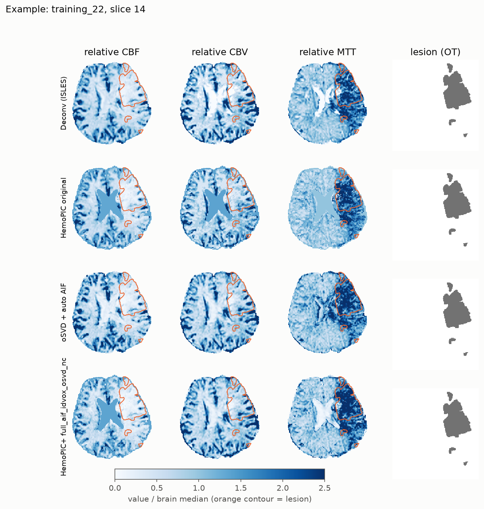

Quality control of the automatic AIF on all 43 subjects: [docs/figures/aif_qc.png](docs/figures/aif_qc.png).

To redraw the figures: `python scripts/make_figures.py --outputs outputs --data-root ../HemoPIC/data/ISLES2017_Training`. The first two figures only need `docs/results`.

## Uncertainty

Each ROI fit is turned into a posterior, p(θ | c) ∝ exp(−κ·L(θ)), with the HemoPIC objective L and one temperature κ per ROI set from the residual noise and the number of effectively independent frames. Its mode is the HemoPIC(+) fit itself, so nothing is refitted. The posterior is sampled with a Laplace approximation (exact Hessian from a differentiable PyTorch copy of the model) and batched MCMC (4 chains, R-hat and ESS reported). Voxel maps of the posterior sd and 95% interval are written next to the fitted maps. A pipeline ensemble (5 k-means seeds and 2 other cluster numbers) measures how much the maps move when the clustering changes. Details and all numbers: [docs/UNCERTAINTY.md](docs/UNCERTAINTY.md) (in Vietnamese).

Data: 43 ISLES 2017 subjects, 651 ROIs, for the original HemoPIC (`baseline`), `full` and `full_aif`.

### Which parameters does the data actually determine?

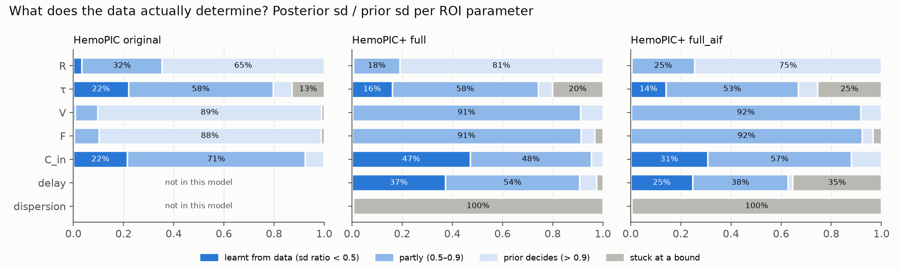

Posterior sd divided by prior sd, per ROI parameter. In the original HemoPIC, F and V are set by their priors (taken from the Deconv maps) in about 90% of ROIs. After the unit fix (C5), the data narrows them in more than 90% of ROIs. R is not identifiable in any config. The dispersion parameter sits at its lower bound in 99% of ROIs, so the data does not use it. With the automatic AIF, the delay sits at its lower bound (−4 s) in 35% of ROIs.

### One ROI in detail

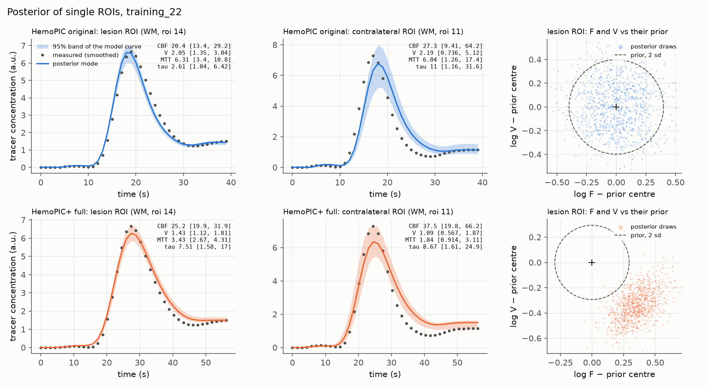

Left and middle: the measured curve, the posterior mode and the 95% band of the model curve for the ROI that overlaps the lesion most and the one that overlaps the contralateral side most (subject 22). The numbers are posterior means with 95% intervals. The original HemoPIC uses dt = 1 s, hence the shorter time axis. Right: posterior draws of (log F, log V) against the prior. In the original HemoPIC the posterior fills the prior; in HemoPIC+ the data moves F and V away from it.

### How wide are the intervals?

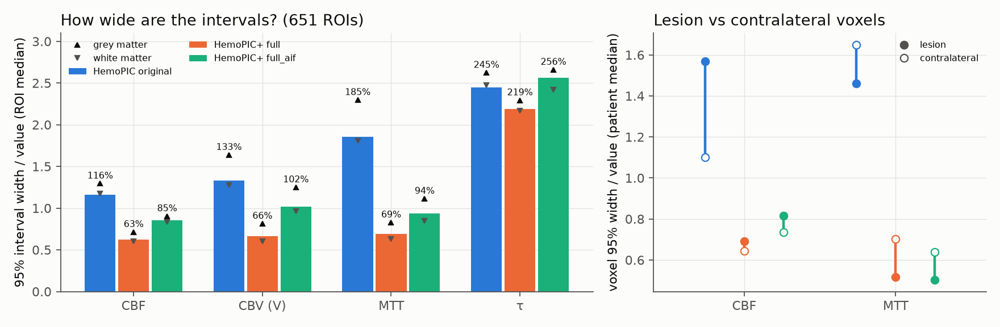

The median 95% interval of CBF shrinks from 116% of its value (original) to 63% (`full`), and MTT from 185% to 69%. τ stays very uncertain (above 200%) in every config. In the original HemoPIC and in `full_aif`, the lesion is more uncertain than the contralateral side for CBF.

### Can the intervals be trusted?

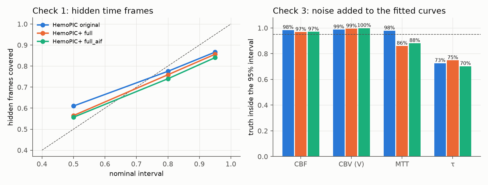

Two checks without a phantom. Check 1 hides one of 5 blocks of time frames, refits on the rest and asks how often the hidden values fall inside the predictive interval. Check 3 takes each fitted curve as the truth, adds noise with the same level and time correlation as the real residuals, refits with the pipeline's own estimator, and asks how often the 95% interval contains the truth (3 repeats × 651 ROIs).

| 95% interval contains the truth | CBF | CBV (V) | MTT | τ |
|---|---|---|---|---|
| HemoPIC original | 98.4% | 98.7% | 97.9% | 72.6% |
| HemoPIC+ full | 96.8% | 99.5% | 86.0% | 74.8% |
| HemoPIC+ full_aif | 97.0% | 99.8% | 88.1% | 70.3% |

The intervals for CBF and CBV are reliable. Those for MTT (in HemoPIC+) and τ are too narrow, by about 1.3× and 2×: their posteriors are often cut by a bound or have several modes. The predictive intervals of hidden frames are slightly too narrow at 95% (84–87%).

### Does the uncertainty help lesion detection?

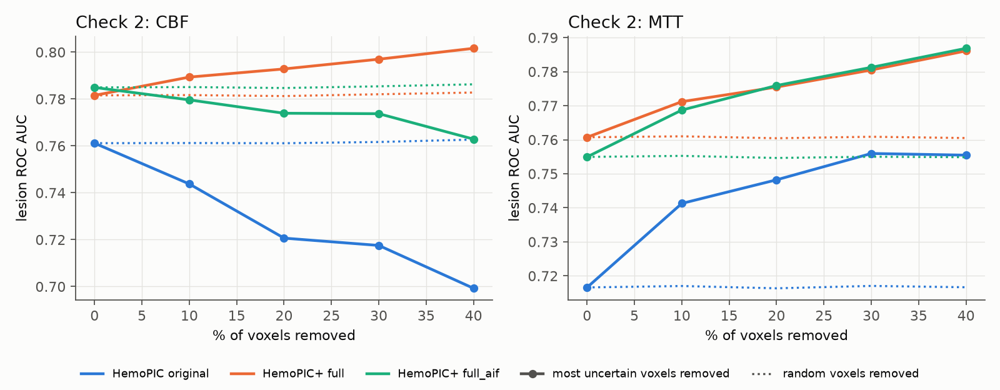

Check 2 removes the q% voxels with the widest relative interval and recomputes the lesion ROC AUC; removing the same number of random voxels leaves the AUC unchanged. For MTT the AUC rises in every config. For CBF it rises only with `full` (0.782 → 0.802). In the original HemoPIC and `full_aif`, the most uncertain CBF voxels are the lesion itself (low flow, weak signal), so removing them lowers the AUC.

### The paper's τ claim with uncertainty

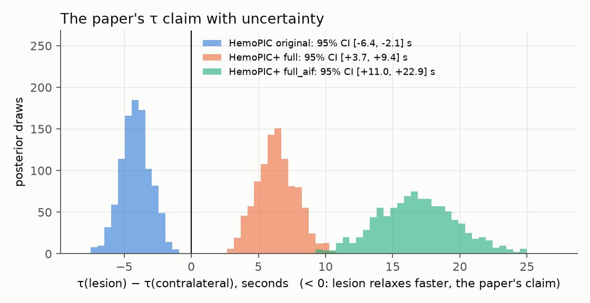

The paper reports a shorter τ in the lesion than on the contralateral side. This holds for the original model (−4.2 s, 95% CI [−6.4, −2.1]), but reverses with high certainty once the units are fixed: +6.3 s, 95% CI [+3.7, +9.4] (`full`) and +16.8 s, [+11.0, +22.9] (`full_aif`).

### Uncertainty maps and pipeline uncertainty

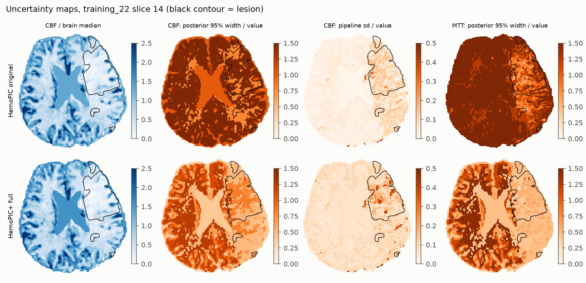

| | lesion AUC CBF over 7 ensemble members | voxel relative sd of CBF: pipeline / posterior |
|---|---|---|
| HemoPIC original | 0.757–0.765 | 2.5% / 27.9% |
| HemoPIC+ full | 0.776–0.783 | 7.1% / 15.3% |
| HemoPIC+ full_aif | 0.779–0.787 | 7.7% / 18.2% |

Changing the k-means seed or the number of clusters moves the AUC by at most 0.008, less than the gain from the original to `full` (+0.020). In HemoPIC+, the pipeline uncertainty is about half the model uncertainty, so it is not negligible.

A side finding: polishing the Powell solution with L-BFGS-B changes the CBF level of an ROI by more than 5% in 8–22% of ROIs, so the pipeline's optimiser often stops before the minimum.

To reproduce (after `run_cohort.py`): `run_uq.py`, `eval_heldout.py`, `eval_semisynth.py`, `eval_uq.py`, `run_ensemble.py`, then `make_uq_figures.py`; see [docs/UNCERTAINTY.md](docs/UNCERTAINTY.md). The cohort summaries are in `docs/results/<config>/uq/`.

## Transport PDE and neural PDE

HemoPIC models each ROI as one well-mixed tank, so its transit times are exponential. On all 651 ROIs the HemoPIC+ fits share a systematic misfit: they miss 14–35% of the bolus peak and overshoot just after it (5 to 16 standard errors). The tank is too blunt.

**Transport PDE.** The tank is replaced by a tube with plug flow and longitudinal dispersion, ∂c/∂t = k(t)(−∂c/∂s + Pe⁻¹ ∂²c/∂s²), with a Danckwerts inlet driven by the same delayed and dispersed arterial input as HemoPIC+. Mass is conserved and the mean transit time stays V/F, so CBF, CBV and MTT keep their meaning. Pe → 0 is exactly HemoPIC+, so the PDE can only fit better. The tube is solved exactly within each frame as a sum of 24 exponential modes, from one symmetric eigendecomposition per ROI.

**Neural PDE.** One tube can only narrow the transit times. ROIs that mix fast and slow tissue need them wider (capillary transit-time heterogeneity). The closure splits each ROI into two parallel tubes; the volume and flow fractions are predicted by a small MLP shared across all patients, from label-free ROI descriptors. Whatever the split, mass and the mean transit time are preserved, so the network can reshape the transit-time distribution but cannot change CBF, CBV or MTT by itself. Evaluation uses 5-fold cross-validation **by patient**: the network is frozen on held-out patients, and the plain PDE is refitted there with the same optimiser.


| | brain nRMSE | lesion nRMSE | AUC CBF | AUC CBV | AUC MTT |
|---|---|---|---|---|---|
| `full_aif`: tank (HemoPIC+, polished) | 0.116 | 0.271 | 0.787 | 0.550 | 0.755 |
| PDE | 0.108 | 0.277 | 0.784 | 0.563 | **0.763** |
| neural PDE (held-out patients) | **0.094** | **0.265** | 0.784 | **0.568** | 0.758 |

- With the true AIF (`full_aif`), the neural PDE lowers the held-out ROI error from 0.0445 to 0.0273 (median) and improves on the plain PDE in all 5 folds. It is also the only variant that fits the lesion better than the tank. AUC CBV rises by 0.018 over the tank (p = 6e−8). CBF, V and MTT move by only 1–2% relative to the plain PDE.
- With the tissue-mean input (`full`), the PDE alone cuts the brain nRMSE from 0.069 to 0.050. The neural part adds nothing: the input is already blunt, so no split is needed, and the network learns not to split.
- The PDE also changes the physics: MTT is 18–34% longer than with the tank (e.g. grey matter 2.9 s → 4.0 s), because a tank lets tracer leave instantly.


In healthy tissue the network sends about 85% of the flow through a fast tube and keeps a slow tube for the tail; the transit-time CV (CTH/MTT) rises from 0.55 to 0.8–0.9. Whether the slow tube is true capillary heterogeneity or absorbs recirculation and AIF errors is not settled yet. Details, paired tests and limitations: [docs/NEURAL_PDE.md](docs/NEURAL_PDE.md) (in Vietnamese).

**Against oSVD with the same AIF** (36 subjects with an accepted AIF, `scripts/compare_osvd.py`), the neural PDE does not improve lesion detection over the tank. CBF is on par with oSVD, or +0.022 with the best map construction (`full_aif_idvox_osvd_nc`), the same as the tank (+0.024). CBV is lower than oSVD unless it is computed by indicator dilution. MTT is best with the plain PDE in `full` (+0.018 over oSVD, p = 0.007). No configuration beats oSVD on all three maps. The neural PDE's contribution is the curve fit and the reliability of the intervals, not the AUC.

### Uncertainty of the neural PDE

The same posterior, Laplace + MCMC, voxel maps and checks run on the eight physical parameters of the neural PDE, with the network of the held-out fold frozen. Network uncertainty is measured with 3 extra bootstrap networks per fold.

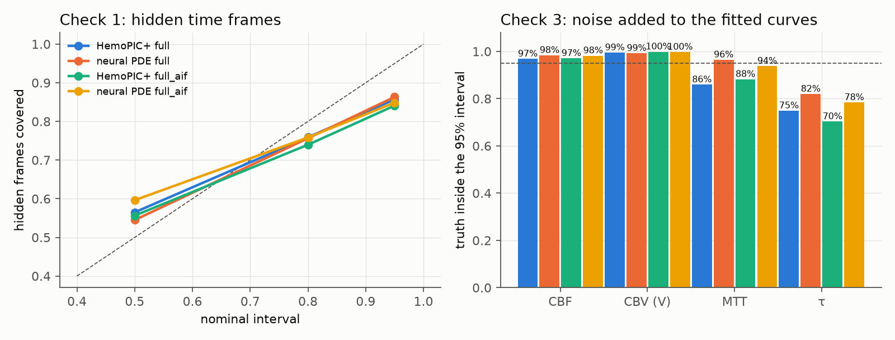

| truth inside the 95% interval (check 3) | CBF | CBV | MTT | τ |
|---|---|---|---|---|
| HemoPIC+ full / full_aif | 96.8 / 97.0% | 99.5 / 99.8% | 86.0 / 88.1% | 74.8 / 70.3% |
| neural PDE full / full_aif | 98.4 / 98.2% | 99.2 / 99.7% | **96.5 / 93.8%** | 82.0 / 78.4% |

- The intervals are both narrower and better calibrated. CBF 95% width falls from 85% to 72% of the value (`full_aif`). The weak point of HemoPIC+, overconfident MTT intervals, is largely fixed, and the MTT error halves (15.7% → 8.9%): the tank had to trade MTT against delay, while the tube separates late arrival from transit.
- Network uncertainty is more than 10 times smaller than the posterior: the voxel CBF sd across networks is 0.6%, against 16.9% from the physical parameters, and the AUC varies by at most 0.005 across networks.
- With `full_aif`, removing uncertain CBF voxels no longer lowers the lesion AUC (HemoPIC+: 0.785 → 0.763; neural PDE: 0.784 → 0.783), because the lesion is no longer where the fit is poor.
- The paper's τ claim stays reversed (+24.6 s, 95% CI [+19.0, +30.3] with `full_aif`).
- Caveat: MCMC mixes worse than for the tank (R-hat > 1.1 in 16% of ROIs vs 5%), because Pe and the delay often sit at a bound. Details: [docs/NEURAL_PDE.md](docs/NEURAL_PDE.md), section 6.

## Repository layout

```
configs/              # one file per experiment (baseline, c1_tr, ..., full)
  isles2017_tr.json   # true TR per subject (C1), produced by preprocess/extract_tr.py
preprocess/           # raw data -> HemoPIC-ready data
  prepare_isles2017.py      # runs every step below
  download_isles2017.py     # downloads the Zenodo zip (resumable) and unzips it
  flatten_isles2017.py      # maps the nested Zenodo layout to MR_rCBF.nii, OT.nii, ...
  extract_tr.py             # measures TR from the DICOM metadata (C1)
  pwi_to_tracer.py          # PWI signal -> concentration (HemoPIC Preprocessing 2)
  segmentation/             # SynthSeg + 4-class tissue labels (HemoPIC Preprocessing 1, needs FreeSurfer)
hemopic_plus/         # library
  config.py  io.py  signal.py  models.py  fit.py  pipeline.py  evaluation.py  aif.py  osvd.py
  uq/                 # uncertainty: torch_model.py (differentiable model), data.py, laplace.py, mcmc.py
  npde/               # transport.py (PDE tissue model, exact modal solver), neural.py (two-tube neural closure),
                      # uqbatch.py (runs the uq/ tools on the PDE model)
scripts/
  run_cohort.py       # fits the whole cohort in parallel
  evaluate.py         # tracer nRMSE + lesion ROC AUC
  compare.py          # comparison table across experiments
  make_figures.py     # the figures in this README
  paired_test.py      # Wilcoxon test + bootstrap CI between two experiments
  plot_aif.py         # QC of the automatic AIF (C6)
  osvd_check.py       # independent reference: oSVD with the same AIF (ROC, between-subject MTT)
  summarize_original_eval.py  # summarises CVT / tau from the original Eval scripts
  run_uq.py           # posterior per ROI (Laplace + MCMC) and voxel uncertainty maps
  eval_heldout.py     # check 1: predictive coverage of hidden time frames
  eval_semisynth.py   # check 3: coverage of a known truth after adding noise and refitting
  eval_uq.py          # identifiability, interval widths, check 2 (removing uncertain voxels), tau claim
  run_ensemble.py     # pipeline uncertainty (k-means seeds and cluster numbers)
  make_uq_figures.py  # the uncertainty figures
  run_pde.py          # refit every ROI with the transport PDE (and the polished tank) and evaluate
  train_npde.py       # neural PDE with patient-level cross-validation
  make_npde_figures.py  # the PDE / neural PDE figures
  run_npde_uq.py      # uncertainty of the neural PDE: posterior, checks 1 and 3, network ensemble
  compare_osvd.py     # PDE / neural PDE against oSVD with the same AIF
tests/                # the baseline must match the original HemoPIC
run_experiments.ps1 / .sh   # runs every experiment
```

## Installation

Clone this repository **next to** the original HemoPIC repository. The default configs read data from `../HemoPIC/data/ISLES2017_Training`, and the test compares against the demo bundled with the original repository.

Windows (PowerShell):

```powershell
python -m venv .venv
.venv\Scripts\activate
pip install -r requirements.txt
python tests\test_baseline_equivalence.py      # should print: all tests passed
```

Linux/macOS: the same, with `source .venv/bin/activate`.

The uncertainty scripts also need PyTorch (CPU is enough): `pip install torch`, then `python tests/test_uq_torch.py`.

## Data

**If you already have preprocessed data** (`../HemoPIC/data/ISLES2017_Training`, 43 subjects with `CTC_from_MR_4DPWI.nii` and `hemopic_seg4/`), nothing else is needed.

**From scratch:**

```bash
python preprocess/prepare_isles2017.py D:/data                  # needs FreeSurfer >= 7.3 for SynthSeg
python preprocess/prepare_isles2017.py D:/data --skip-synthseg  # on a machine without FreeSurfer
```

Then set `data_root` in the configs, or pass `--data-root D:/data/ISLES2017_Training` when running.

The Zenodo release has 43 subjects (training_1..48, with 3, 17, 25, 29 and 34 missing); the paper used 44.

## Running

```powershell
# one experiment
python scripts\run_cohort.py configs\full.yaml          # fits 43 subjects -> outputs\full\training_XX\
python scripts\evaluate.py  configs\full.yaml           # -> outputs\full\eval\summary.json

# a few subjects, limited number of processes
python scripts\run_cohort.py configs\full.yaml --patients 1 22 --workers 4

# every experiment + comparison table (outputs\comparison.md)
powershell -ExecutionPolicy Bypass -File run_experiments.ps1
```

The outputs keep HemoPIC's file layout (`HemoPIC_CBF/CBV/MTT.nii.gz`, `roi_fit_summary.csv`, ...), so the original repository's `Eval/` scripts (CVT, tau, summary statistics, slice maps) run on them unchanged, for example:

```bash
python ../HemoPIC/Eval/cvt_check/run_eval_cvt.py ../HemoPIC/data/ISLES2017_Training outputs/full outputs/full/eval_cvt
```

For nRMSE, use `scripts/evaluate.py`: the original tracer script rebuilds the curves with the original model, which is wrong for the new model variants.

## Configuration

Every key is defined, with comments, in `hemopic_plus/config.py`; the defaults are the original behaviour. A config only lists the keys that differ from the defaults:

```yaml
name: my_experiment
data: {data_root: ../HemoPIC/data/ISLES2017_Training, out_root: outputs}
time: {dt_source: tr_table}
model: {flow_per_minute: true, delay_dispersion: true, delay_bounds: [-4, 10]}
robust: {multistart: 4}
reference_free: {prior_source: tracer, cbv_texture: tracer_auc, map_bounds: fixed}
partition: {k_gm: 16, k_wm: 12}
```

## License

Code copied and adapted from HemoPIC (MIT, © 2026 LDR Group @ JHU) is marked "(HemoPIC)" in the source; see `LICENSE_HemoPIC`.
