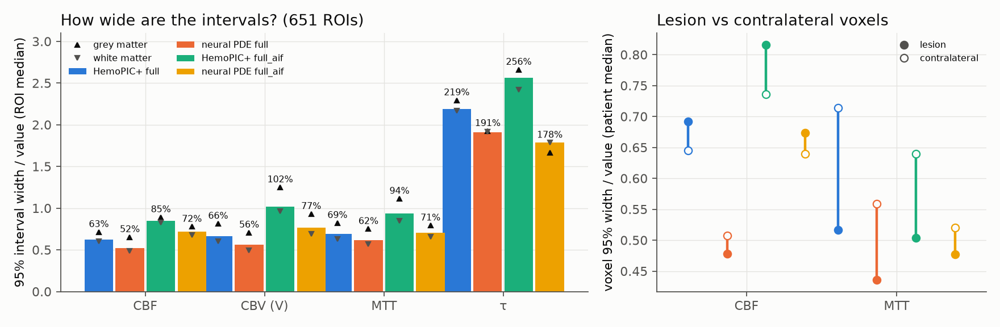
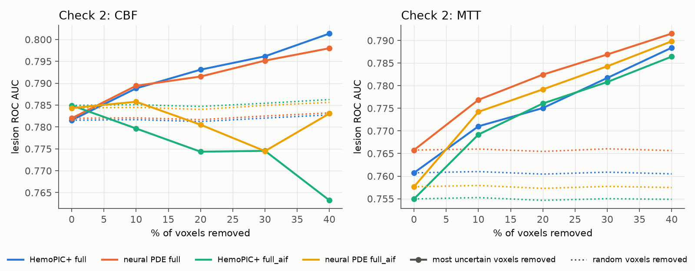
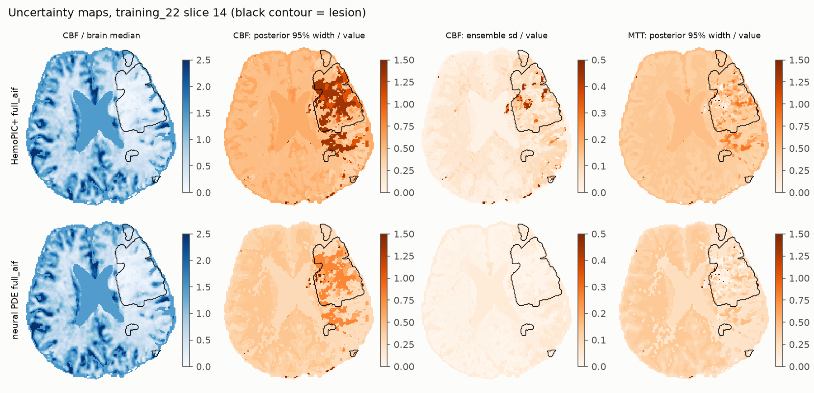
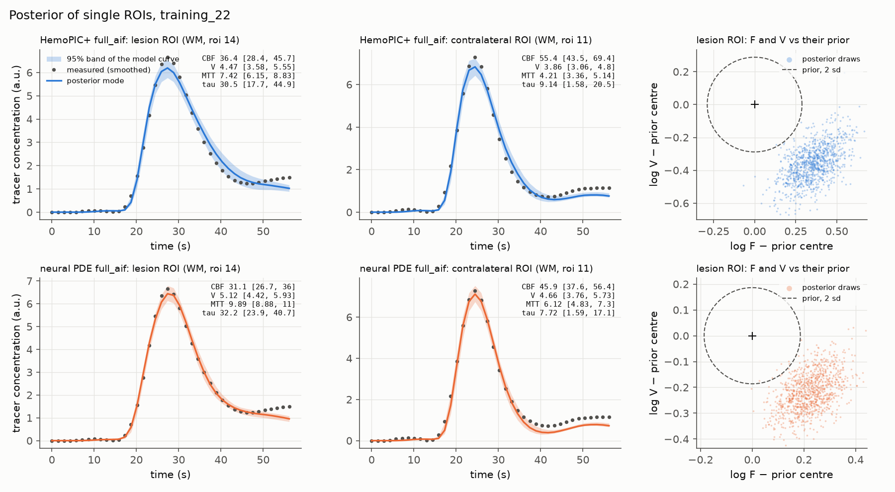
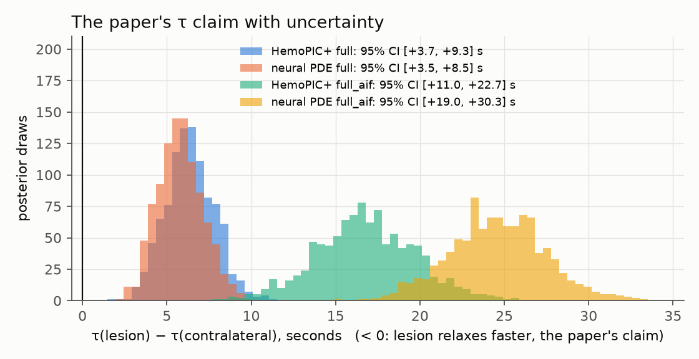
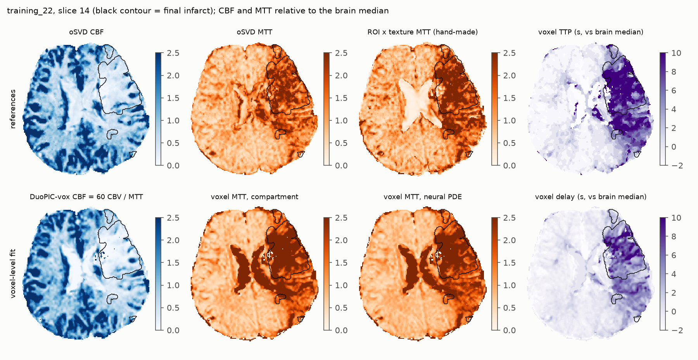
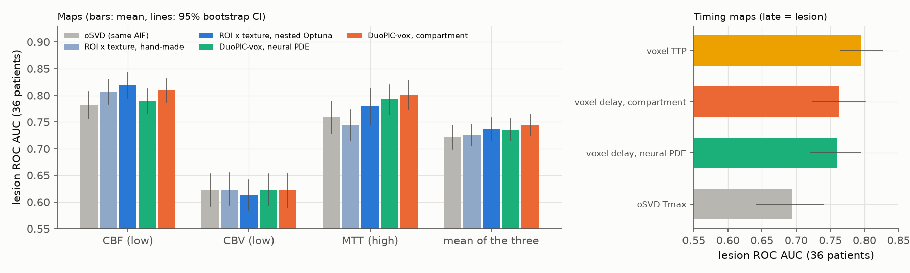
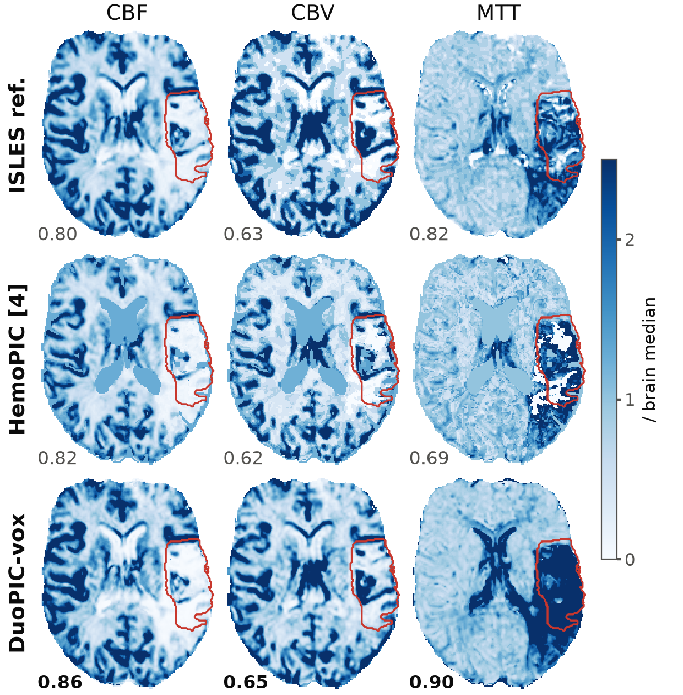
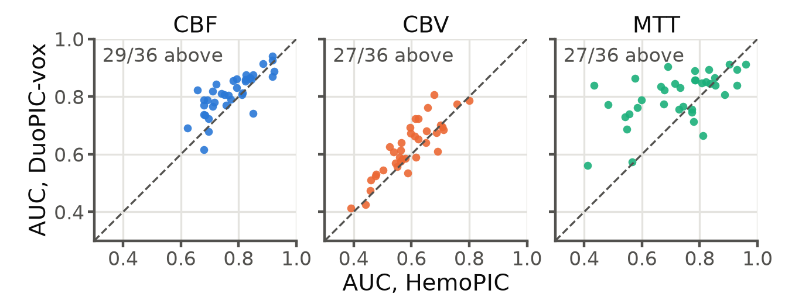

# HemoPIC+ — PDE vận chuyển và neural PDE

HemoPIC coi mỗi ROI là **một bể trộn đều** (một ngăn): thuốc vào bể là trộn đều ngay, nên phân bố thời gian đi qua mô là hàm mũ. Phần này thay bể bằng **một ống có dòng chảy và trộn dọc đường** (PDE vận chuyển–khuếch tán), rồi thêm một **mạng neural nhỏ, dùng chung cho cả cohort**, học cách mỗi ROI tách thành hai đường song song nhanh và chậm (neural PDE).

## 1. Vì sao cần

Lấy trung bình sai số (đo − fit) theo thời gian quanh đỉnh bolus trên 651 ROI của HemoPIC+ thì thấy một quy luật rõ, không phải nhiễu:

- mô hình **thấp hơn đỉnh đo 14–35% chiều cao đỉnh**, ở mọi nhóm (chất xám, chất trắng, tổn thương);
- ngay sau đỉnh, mô hình lại **cao hơn** số đo (−0.05 đến −0.08 của đỉnh, ở mô lành);
- với AIF tự động, phần đuôi bị thiếu (+0.05 đến +0.08).

Độ lệch gấp 5–16 lần sai số chuẩn. Nói đơn giản, bể trộn đều làm đường cong **tù hơn thực tế**. Điều này khớp với phần uncertainty: tham số dispersion của [C2] luôn dính cận dưới, tức dữ liệu muốn đường cong nhọn hơn mức bể trộn cho phép.

## 2. PDE vận chuyển

Mỗi ROI là một ống, s ∈ [0, 1] là phần thể tích máu đã đi qua:

  ∂c/∂t = k(t) · ( −∂c/∂s + (1/Pe) ∂²c/∂s² ),  k(t) = q(t) / (60 V)

- đầu vào (Danckwerts): c − (1/Pe) ∂c/∂s = (F/q) · c_in(t), với c_in là đường động mạch đã trễ và phân tán như [C2];
- đầu ra: ∂c/∂s = 0;
- đường cong mô: C(t) = ∫ c ds.

Tích phân theo s cho dC/dt = k (F/q · c_in − c(1)). Vậy **tracer được bảo toàn và thời gian đi qua trung bình đúng bằng 1/k**: CBF, CBV và MTT = 60 V / CBF giữ nguyên ý nghĩa (định lý thể tích trung tâm). Pe là tham số thứ 8 của mỗi ROI:

- Pe → 0: trộn đều, **đúng bằng HemoPIC+** (bể + bộ lọc đầu vào);
- Pe lớn: gần như đẩy thẳng (plug flow), đường cong nhọn hơn.

Vì PDE chứa HemoPIC+ như một trường hợp đặc biệt, fit bằng PDE (có một điểm xuất phát tại Pe = 0.02) không bao giờ tệ hơn HemoPIC+ trên từng ROI.

**Giải số.** 24 ô thể tích hữu hạn (đối lưu upwind, khuếch tán trung tâm). Trong mỗi frame, k và c_in được giữ cố định như `tracer_update` của HemoPIC, và hệ tuyến tính được giải **chính xác**. Toán tử là ma trận ba đường chéo, đồng dạng với một ma trận đối xứng, nên đường cong là tổng của 24 mode mũ: chỉ cần một phép phân rã trị riêng cho mỗi ROI, thay cho một phép mũ ma trận ở mỗi frame (nhanh hơn khoảng 10 lần). Cận Pe ≤ 100. Với 24 ô, độ khuếch tán số đặt sàn cho CV của thời gian đi qua ở khoảng 0.25.

**Kiểm tra tự động** (`tests/test_npde.py`):
1. 1 ô (mọi Pe) khớp HemoPIC+ tới 1e−16;
2. Pe → 0 khớp HemoPIC+ tới 1e−6;
3. với đầu vào hằng, mọi biến thể (một ống, nhiều đường song song, thể tích và độ trộn không đều) đều đầy tới cùng một trạng thái cân bằng (bảo toàn khối lượng);
4. lời giải dạng mode khớp lời giải bằng mũ ma trận tới 1e−9;
5. phân bố thời gian đi qua của mọi biến thể có tích phân 1 và trung bình 1 (theo đơn vị MTT).

## 3. Neural PDE: độ không đồng nhất của thời gian đi qua

Một ống chỉ làm phân bố thời gian đi qua **hẹp hơn** bể trộn (hệ số biến thiên CV từ 1 xuống khoảng 0.25). ROI chứa cả mô nhanh lẫn mô chậm, ví dụ một phần tổn thương nằm trong ROI lành, lại cần phân bố **rộng hơn**. Trong sinh lý học, đó chính là độ không đồng nhất của thời gian đi qua mao mạch (CTH, Østergaard), một chỉ số đáng chú ý trong đột quỵ.

Lý thuyết pha loãng chỉ thị yêu cầu động học tracer **tuyến tính** và **bảo toàn khối lượng**. Trong hai ràng buộc đó, phần mạng neural được học là: ROI tách thành **hai ống song song** cùng nhận một nồng độ đầu vào, với phần thể tích (ν, 1 − ν) và phần dòng chảy (φ, 1 − φ). Ống m chạy với tốc độ k · φ_m / ν_m, đường cong mô là Σ ν_m C_m. Dù chia thế nào thì thời gian đi qua trung bình vẫn là Σ φ_m · (ν_m / φ_m) / k = 1/k, nên **CBF, CBV, MTT vẫn đúng nghĩa vật lý; mạng chỉ đổi được hình dạng phân bố thời gian đi qua**, không "nuốt" được phần vật lý.

Một đường cong không đủ để xác định (ν, φ) cùng với 8 tham số vật lý (phần uncertainty đã cho thấy R và dispersion còn không xác định được). Vì vậy (ν, φ) do **một mạng MLP nhỏ dùng chung cho mọi ROI của mọi bệnh nhân** dự đoán (2 lớp ẩn × 32, khoảng 1.4 nghìn tham số), từ các đặc trưng **không dùng nhãn tổn thương hay bản đồ tham chiếu**: loại mô, prior F và V từ tracer, log(V/F), thời gian tới đỉnh và độ rộng nửa đỉnh của đường cong so với đường động mạch.

**Huấn luyện và đánh giá.** Kiểm tra chéo 5 phần **theo bệnh nhân**. Với mỗi phần:
- huấn luyện mạng cùng với tham số vật lý của các ROI thuộc bệnh nhân huấn luyện (Adam, 1500 bước);
- trên bệnh nhân bị giữ lại, **cố định mạng**, chỉ fit tham số vật lý của từng ROI (1000 bước);
- fit lại PDE thường trên đúng các bệnh nhân đó với **cùng bộ tối ưu và cùng số bước**, nên hai bên chỉ khác nhau ở phần mạng.

Mọi chỉ số của neural PDE vì vậy đều tính trên bệnh nhân mà mạng **chưa từng thấy**. Lúc khởi tạo, mạng gần như là PDE thường (hai ống tốc độ 1.13 và 0.87 lần trung bình). Lý do không khởi tạo đúng bằng hai ống giống hệt: đó là một điểm yên ngựa đối xứng, gradient theo cách chia bằng 0. Một phạt nhỏ trên logit(ν) − logit(φ) kéo hai tốc độ về gần nhau, trừ khi dữ liệu cần tách.

## 4. Kết quả

43 bệnh nhân, 651 ROI, hai cấu hình: `full` (đầu vào là đường trung bình của mô, không dùng AIF) và `full_aif` (AIF tự động). Chạy trên Windows (RTX 4090, 32 luồng, CPU), mất 17 phút cho cả hai cấu hình. Các mức so sánh:

- **tank (pipeline)**: HemoPIC+ như trong pipeline (Powell);
- **tank, polished**: cùng mô hình, đánh bóng thêm bằng L-BFGS-B. Đây là mốc công bằng, tách phần lợi do bộ tối ưu khỏi phần lợi do mô hình;
- **PDE**: ống vận chuyển (8 tham số, chứa HemoPIC+ khi Pe → 0);
- **neural PDE**: PDE + mạng dự đoán hai ống song song. Mọi số của neural PDE đều tính trên **bệnh nhân bị giữ lại**.


### 4.1 Bảng tổng hợp

| | nRMSE GM | nRMSE WM | nRMSE tổn thương | nRMSE đối bên | nRMSE toàn não | AUC CBF | AUC CBV | AUC MTT |
|---|---|---|---|---|---|---|---|---|
| **full**: tank (pipeline) | 0.081 | 0.072 | 0.260 | 0.144 | 0.069 | 0.782 | 0.546 | 0.761 |
| tank, polished | 0.080 | 0.072 | 0.259 | 0.144 | 0.069 | 0.783 | 0.545 | 0.760 |
| PDE | **0.062** | **0.053** | 0.268 | **0.132** | **0.050** | 0.782 | **0.556** | **0.766** |
| neural PDE (giữ lại) | **0.062** | 0.054 | 0.268 | **0.132** | **0.050** | 0.782 | **0.556** | **0.766** |
| **full_aif**: tank (pipeline) | 0.120 | 0.123 | 0.271 | 0.182 | 0.117 | 0.785 | 0.560 | 0.755 |
| tank, polished | 0.119 | 0.122 | 0.271 | 0.182 | 0.116 | 0.787 | 0.550 | 0.755 |
| PDE | 0.109 | 0.114 | 0.277 | 0.172 | 0.108 | 0.784 | 0.563 | **0.763** |
| neural PDE (giữ lại) | **0.100** | **0.101** | **0.265** | **0.164** | **0.094** | 0.784 | **0.568** | 0.758 |

Kiểm định cặp theo bệnh nhân (Wilcoxon, 43 bệnh nhân):

| | Δ nRMSE toàn não | Δ nRMSE tổn thương | Δ AUC CBF | Δ AUC CBV | Δ AUC MTT |
|---|---|---|---|---|---|
| full: PDE − tank polished | −0.019 (p = 5e−13) | +0.008 (p = 2e−6) | −0.001 (p = 0.06) | +0.011 (p = 6e−9) | +0.005 (p = 3e−5) |
| full: neural − PDE | −0.0002 (p = 0.10) | 0.000 | 0.000 | 0.000 | 0.000 |
| full_aif: PDE − tank polished | −0.008 (p = 2e−7) | +0.007 (p = 9e−5) | −0.003 (p = 6e−5) | +0.012 (p = 8e−8) | +0.008 (p = 1e−6) |
| full_aif: neural − PDE | −0.014 (p = 8e−9) | −0.012 (p = 9e−6) | +0.001 (p = 0.08) | +0.005 (p = 0.004) | −0.005 (p = 0.009) |
| full_aif: neural − tank polished | −0.022 (p = 7e−13) | −0.006 (p = 0.18) | −0.003 (p = 0.09) | **+0.018 (p = 6e−8)** | +0.003 (p = 0.55) |

### 4.2 PDE thường

- **Fit tốt hơn rõ rệt ở mô lành.** Sai số theo ROI giảm 34% (trung vị) với `full`, nRMSE toàn não 0.069 → 0.050. Với `full_aif`, mức giảm nhỏ hơn: 0.116 → 0.108.
- **Dữ liệu muốn đường cong nhọn.** Với `full`, Pe chạm cận trên ở 69% ROI. Lý do là đầu vào ở đây là đường trung bình của mô, vốn đã bị làm tù, nên ROI chỉ cần thêm rất ít độ phân tán. Với AIF thật (`full_aif`), Pe trung vị là 5.9 (CV thời gian đi qua khoảng 0.55), và chỉ 35% ROI chạm cận.
- **Tham số vật lý thay đổi có hệ thống.** So với bể trộn, MTT dài hơn (×1.34 với `full`, ×1.18 với `full_aif`), CBF thấp hơn 8–13%, CBV cao hơn 9–16%. Bể trộn cho thuốc bắt đầu ra khỏi mô ngay lập tức, nên phải dồn phần trễ vào tham số delay và đánh giá thấp MTT. Ví dụ ở chất xám bệnh nhân 22, MTT từ 2.9 s lên 4.0 s, gần với giá trị thường gặp trong DSC-MRI hơn.
- **AUC của CBV và MTT tăng nhẹ nhưng có ý nghĩa** (+0.011/+0.012 và +0.005/+0.008). CBF không đổi.
- **nRMSE vùng tổn thương tăng nhẹ (+0.007/+0.008), dù trên từng ROI PDE luôn fit tốt hơn hoặc bằng bể trộn** (đã kiểm: hàm mục tiêu của PDE ≤ của tank trên mọi ROI). Chỉ số này so trung bình các đường cong ROI (theo phần trùng) với đường cong trung bình của riêng voxel tổn thương. Tổn thương thường chỉ chiếm một phần nhỏ của ROI, và phần đó đến muộn, kéo dài. Đường cong ROI càng tù (như bể trộn) thì lại càng "giống" voxel tổn thương một cách ngẫu nhiên. Đây là giới hạn của cách đo, không phải PDE fit kém hơn.

### 4.3 Neural PDE


- **Với `full`: không thêm gì.** Trên bệnh nhân bị giữ lại, neural PDE trùng với PDE thường (chênh lệch ≤ 2e−4, CBF/V/MTT không đổi). Đầu vào đã tù sẵn, nên mô hình chỉ cần thu hẹp phân bố thời gian đi qua, trong khi hai ống song song chỉ làm nó rộng ra. Mạng học ra rằng không nên tách, và điều đó đúng.
- **Với `full_aif`: cải thiện rõ trên bệnh nhân chưa từng thấy.** Sai số theo ROI (trung vị) 0.0445 → 0.0273, giảm ở cả 5 fold (giảm 15–49% tuỳ fold). nRMSE toàn não 0.108 → 0.094, chất trắng 0.114 → 0.101. **Vùng tổn thương cũng tốt hơn** (0.277 → 0.265), lần này còn tốt hơn cả bể trộn, vì hai ống làm được phân bố rộng mà một ống không làm được.
- **AUC CBV tốt nhất trong mọi biến thể** (0.568, +0.018 so với tank polished, p = 6e−8). AUC MTT giảm 0.005 so với PDE thường nhưng vẫn ngang bể trộn. AUC CBF không đổi.
- **Phần vật lý không bị mạng "nuốt".** So với PDE thường, CBF, V và MTT chỉ đổi 1.3%, 0.8% và 2.2% (trung vị). Điều này đúng như thiết kế: mạng chỉ đổi được hình dạng phân bố thời gian đi qua.
- Hình sai số trên cho thấy cụ thể: với `full_aif`, phần đuôi bị thiếu ở chất trắng (+0.1 của đỉnh) **biến mất** với neural PDE, và độ lệch tại đỉnh ở vùng tổn thương giảm từ 0.32 xuống 0.23. Với `full`, cả ba đường gần như trùng nhau sau đỉnh.


**Mạng học được gì (`full_aif`).** Ở mô lành, mạng tách mỗi ROI thành một **ống nhanh mang khoảng 85% dòng chảy** và một ống chậm hơn 10–30 lần, giữ phần đuôi. CV của thời gian đi qua (CTH/MTT) tăng từ 0.54 lên 0.77 ở chất xám và từ 0.57 lên 0.88 ở chất trắng. Mức này cùng cỡ với tỉ số CTH/MTT ≈ 1 thường được báo cáo cho mô lành. Ở ROI tổn thương, mạng gần như không tách (CV khoảng 0.4).

**Cần thận trọng khi diễn giải.** Ống chậm có thể là độ không đồng nhất mao mạch thật, nhưng cũng có thể đang "hấp thụ" những gì mô hình chưa có: tái tuần hoàn mà AIF tự động không bắt được, sai số hiệu chỉnh thể tích từng phần của AIF, hoặc thuốc thoát mạch. Muốn phân biệt cần phantom có đáp án, hoặc dữ liệu có CTH đo độc lập.


### 4.4 So với oSVD dùng cùng AIF

oSVD (deconvolution chuẩn, Wu et al. 2003) với cùng AIF tự động và TR thật là mốc so sánh công bằng (xem `docs/RESULTS.md`, mục 2d). AUC tổn thương trên 36 bệnh nhân có AIF đạt chuẩn (`scripts/compare_osvd.py`); trong ngoặc là chênh lệch so với oSVD và p (Wilcoxon):

| | AUC CBF | AUC CBV | AUC MTT | r MTT toàn não với oSVD |
|---|---|---|---|---|
| oSVD + AIF tự động | 0.782 | 0.623 | 0.759 | – |
| full (bể) | 0.786 (+0.003, p = 0.9) | 0.535 (−0.088, p = 5e−8) | 0.773 (+0.014, p = 0.014) | +0.54 |
| full: PDE = neural PDE | 0.785 (+0.003, p = 0.9) | 0.547 (−0.076, p = 2e−7) | **0.777 (+0.018, p = 0.007)** | +0.49 |
| full_aif (bể) | 0.790 (+0.007, p = 0.4) | 0.552 (−0.071, p = 2e−6) | 0.766 (+0.007, p = 0.11) | −0.01 |
| full_aif: PDE | 0.787 (+0.005, p = 0.7) | 0.555 (−0.068, p = 6e−7) | 0.774 (+0.015, p = 0.03) | −0.14 |
| full_aif: neural PDE | 0.788 (+0.006, p = 0.5) | 0.561 (−0.061, p = 1e−6) | 0.768 (+0.009, p = 0.09) | −0.21 |
| bản đồ tốt nhất (idvox_osvd_nc), bể | **0.807 (+0.024, p = 3e−4)** | 0.623 (0.000) | 0.745 (−0.014, p = 0.03) | +0.61 |
| bản đồ tốt nhất + mức CBF của PDE | 0.804 (+0.021, p = 0.002) | 0.623 (0.000) | 0.743 (−0.016, p = 0.03) | +0.54 |
| bản đồ tốt nhất + mức CBF của neural PDE | 0.804 (+0.022, p = 0.002) | 0.623 (0.000) | 0.740 (−0.019, p = 0.01) | +0.48 |

"Bản đồ tốt nhất" là cách dựng `full_aif_idvox_osvd_nc`: CBV theo pha loãng chỉ thị từng voxel, phân bố CBF trong ROI theo oSVD, mức CBF của ROI do mô hình fit. Ở hai dòng cuối, chỉ mức CBF của ROI được thay bằng của PDE / neural PDE (fit của `full_aif` và của cấu hình này trùng nhau hoàn toàn).

**Kết luận: so với oSVD, neural PDE không tốt hơn mô hình bể ở khâu phát hiện tổn thương.**
- **CBF**: ngang oSVD với cách dựng bản đồ thường; hơn oSVD (+0.022) khi dùng cách dựng tốt nhất, nhưng mô hình bể cũng hơn y như vậy (+0.024). Lợi thế này đến từ cách dựng bản đồ, không đến từ mô hình mô.
- **CBV**: thua oSVD rõ (−0.06 đến −0.09) với cách dựng thường. Neural PDE thu hẹp được một chút (−0.071 → −0.061). Với cách dựng tốt nhất thì CBV chính là phép pha loãng chỉ thị nên ngang oSVD.
- **MTT**: kết quả tốt nhất so với oSVD là **PDE ở `full`** (+0.018, p = 0.007), nhỉnh hơn mô hình bể (+0.014). Với AIF thật, PDE thường hơn oSVD (+0.015, p = 0.03), còn neural PDE thì không có ý nghĩa.
- **Mức MTT giữa các bệnh nhân** vẫn không khớp oSVD khi dùng AIF thật (r = −0.01 với bể, −0.21 với neural PDE). Hạn chế này của HemoPIC+ (`docs/RESULTS.md`, mục 2d) chưa được giải quyết.
- **Chưa có cấu hình nào thắng oSVD ở cả 3 bản đồ.** Đóng góp của neural PDE nằm ở độ khớp đường cong và độ tin cậy của khoảng sai số (mục 4.3, 6), không nằm ở AUC.

### 4.5 Phát hiện phụ: ROI fit hỏng âm thầm

Đếm trên kết quả pipeline: có **84 / 55 / 65 ROI** (baseline / full / full_aif, trên 651) được báo `success = True` nhưng sai số chuẩn hoá > 0.5, tức đường cong mô hình gần như bằng 0:
- ở HemoPIC gốc, V co về khoảng 0.001;
- ở HemoPIC+, prior F tính từ độ dốc cực đại ra gần 0 và cận [0.2, 5] × prior không cho F thoát ra.

PDE và neural PDE không sửa được những ROI này. Chúng nằm trong cả hai phía của mọi so chênh nên không làm lệch kết luận, nhưng nên thêm bước kiểm tra chất lượng ROI (ngưỡng trên sai số sau fit, nới cận F khi prior quá nhỏ).

## 5. Hạn chế và bước tiếp theo

- **Sàn độ phân tán số.** Với 24 ô, CV nhỏ nhất là khoảng 0.25. Ở `full`, Pe chạm cận trên ở 69% ROI, tức dữ liệu muốn đường cong còn nhọn hơn mức mô hình cho phép. Tăng số ô làm lời giải dạng mode kém ổn định ở Pe lớn; cần một sơ đồ bậc cao hơn hoặc lời giải giải tích của bài toán Danckwerts.
- **Chỉ số nRMSE vùng tổn thương không đo đúng cái được fit** (xem 4.2). Nên bổ sung chỉ số tính trên ROI chủ yếu là tổn thương, hoặc fit riêng phần tổn thương.
- **So với oSVD**, neural PDE không cải thiện AUC tổn thương (mục 4.4); MTT theo mức giữa các bệnh nhân vẫn không khớp oSVD khi dùng AIF thật.
- **MCMC của neural PDE hội tụ kém hơn bể trộn** (R-hat > 1.1 ở khoảng 16% ROI so với 5%), vì Pe và delay hay chạm cận. Xem mục 6.
- **Ý nghĩa sinh lý của hai ống** cần kiểm chứng (xem 4.3).
- Neural PDE chỉ có ích khi đầu vào là AIF thật. Đây là thêm một lý do để dùng `full_aif` làm cấu hình chính.

## 6. Uncertainty của neural PDE

Dùng lại nguyên bộ công cụ của `docs/UNCERTAINTY.md` trên 8 tham số vật lý của neural PDE, mạng của fold tương ứng được giữ cố định:

- **posterior của tham số vật lý**: cùng posterior có nhiệt độ (mode = nghiệm fit), Laplace + MCMC (4 chuỗi, 3000 + 6000 bước); bản đồ sd và khoảng 95% theo voxel như HemoPIC+;
- **bất định của chính mạng**: mỗi fold huấn luyện thêm 3 mạng trên tập bệnh nhân huấn luyện lấy mẫu lại có hoàn lại (bootstrap theo bệnh nhân, seed khác). Với bệnh nhân bị giữ lại, fit lại bằng từng mạng rồi đo độ dao động của CBF, V, MTT, τ và của AUC giữa 4 mạng;
- **ba phép kiểm tra** như với HemoPIC+. Check 3 (semi-synthetic) fit lại bằng chính bộ ước lượng của PDE, xuất phát từ prior (L-BFGS-B, 3 điểm xuất phát của Pe).

Lớp `hemopic_plus/npde/uqbatch.py` (`PDEBatch`) cho `uq/laplace.py`, `uq/mcmc.py` và các phép kiểm tra chạy nguyên vẹn trên mô hình PDE; nhánh HemoPIC+ cho kết quả y hệt trước khi sửa (đã kiểm: sai lệch 0). Chạy trên Windows, 35 phút cho cả hai cấu hình.

### 6.1 Khoảng tin cậy có đúng không?


**Check 3, semi-synthetic** (tỉ lệ đáp án nằm trong khoảng 95%; trong ngoặc: độ rộng trung vị / sai số trung vị của ước lượng, theo % giá trị thật):

| | CBF | CBV (V) | MTT | τ |
|---|---|---|---|---|
| HemoPIC+ full | 96.8% (59% / 9.2%) | 99.5% (70% / 8.0%) | 86.0% (76% / 19.5%) | 74.8% (163% / 16.1%) |
| neural PDE full | 98.4% (51% / 3.9%) | 99.2% (54% / 3.4%) | **96.5%** (62% / 7.6%) | 82.0% (145% / 20.4%) |
| HemoPIC+ full_aif | 97.0% (87% / 8.3%) | 99.8% (93% / 6.0%) | 88.1% (75% / 15.7%) | 70.3% (130% / 16.0%) |
| neural PDE full_aif | 98.2% (69% / 5.2%) | 99.7% (72% / 3.7%) | **93.8%** (59% / 8.9%) | 78.4% (95% / 11.7%) |

**Khoảng tin cậy của neural PDE vừa hẹp hơn vừa đúng hơn.** Điểm yếu lớn nhất của HemoPIC+ là MTT quá tự tin (86–88%); với neural PDE, MTT gần đạt mức 95% (93.8–96.5%), và sai số của ước lượng MTT giảm khoảng một nửa (15.7–19.5% → 7.6–8.9%). Lý do: bể trộn buộc phải đổi MTT lấy delay (hai tham số bù trừ nhau), còn ống vận chuyển tách được thời gian đến muộn khỏi thời gian đi qua mô. τ cũng tốt lên (70–75% → 78–82%) nhưng vẫn còn quá hẹp.

**Check 1, giấu frame** (mức 50 / 80 / 95%): neural PDE full 54.5 / 75.6 / 86.3%, full_aif 59.6 / 75.9 / 84.8%, so với HemoPIC+ 56.5 / 75.9 / 85.6% và 55.7 / 74.0 / 84.0%. Thay đổi rất ít: phần sai lệch còn lại ở mức 95% (đuôi dày của phần dư, nhất là quanh đỉnh) chưa được mô hình hoá.

### 6.2 Độ rộng và Check 2



Độ rộng trung vị của khoảng 95% (theo % giá trị), neural PDE so với HemoPIC+:

| | CBF | CBV | MTT | τ |
|---|---|---|---|---|
| full | 52% (63%) | 56% (66%) | 62% (69%) | 191% (219%) |
| full_aif | 72% (85%) | 77% (102%) | 71% (94%) | 178% (256%) |



**Check 2, bỏ voxel bất định nhất.** MTT: AUC tăng ở cả hai cấu hình (0.766 → 0.792 và 0.758 → 0.790), như HemoPIC+. CBF với `full_aif`: HemoPIC+ **giảm** (0.785 → 0.763) vì chỗ bất định nhất chính là vùng tổn thương; với neural PDE, AUC giữ nguyên (0.784 → 0.783), và tổn thương không còn bất định hơn bên đối diện một cách có hệ thống (51% bệnh nhân so với 72%). Bể trộn fit kém vùng tổn thương nên bất định ở đó phình ra; mô hình fit được vùng tổn thương thì bất định không còn "đánh dấu" tổn thương nữa.

### 6.3 Bất định do mạng neural

| | AUC CBF qua 4 mạng | AUC CBV | AUC MTT | sd tương đối voxel CBF: mạng / posterior |
|---|---|---|---|---|
| full | 0.782–0.782 | 0.556–0.557 | 0.763–0.766 | 0.0% / 11.8% |
| full_aif | 0.783–0.785 | 0.568–0.570 | 0.753–0.758 | 0.6% / 16.9% |

Trên từng ROI, sd của log CBF giữa các mạng là 0.009 so với 0.19 của posterior (full_aif), log MTT 0.014 so với 0.18. **Bất định do mạng nhỏ hơn bất định của tham số vật lý hơn 10 lần**, và nhỏ hơn cả bất định do pipeline của HemoPIC+ (đổi seed và số cụm k-means: 7–9%). Điều này đúng như thiết kế: mạng chỉ đổi hình dạng phân bố thời gian đi qua, còn CBF, CBV, MTT do tham số vật lý quyết định. (Bất định do pipeline chưa được chạy lại cho neural PDE; nên coi 7–9% của HemoPIC+ là cận dưới của phần này.)



Bản đồ ví dụ (bệnh nhân 22, hàng trên HemoPIC+ full_aif, hàng dưới neural PDE full_aif): khoảng 95% của CBF trong vùng tổn thương hẹp đi rõ; cột "ensemble sd" là đổi pipeline với HemoPIC+ và đổi mạng với neural PDE.



### 6.4 Kết luận τ của bài báo



τ(tổn thương) − τ(đối bên): neural PDE full +5.7 s [+3.5, +8.5], full_aif +24.6 s [+19.0, +30.3] (HemoPIC+: +6.3 s [+3.7, +9.4] và +16.8 s [+11.0, +22.9]). Kết luận "tổn thương hồi phục nhanh hơn" của bài báo **vẫn đảo chiều** khi đổi mô hình mô; độ lớn với AIF thật phụ thuộc mô hình (16.8 → 24.6 s), nên chỉ nên tin vào dấu, không nên tin vào con số.

### 6.5 Hạn chế

- **Hội tụ MCMC kém hơn**: R-hat > 1.1 ở 15.5% / 16.1% ROI (full / full_aif) so với 5.7% / 5.4% của HemoPIC+; ESS nhỏ nhất có trung vị 220–240. Pe chạm cận ở 46–75% ROI và delay ở 33% ROI (full_aif), nên posterior bị cắt ở biên. Nên chạy chuỗi dài hơn, hoặc tham số hoá Pe để không có cận cứng.
- Check 3 sinh dữ liệu từ chính mô hình được kiểm tra (cho cả hai mô hình), nên nó đo độ tin cậy *khi mô hình đúng*. Check 1 (dữ liệu thật) gần như không đổi: phần sai lệch chưa được mô hình hoá vẫn làm khoảng 95% chỉ phủ 85–86%.
- Mạng được giữ cố định trong posterior; bất định của mạng chỉ đo bằng 4 mạng bootstrap mỗi fold.

## 7. Mô hình ở mức voxel (DuoPIC-vox)

**Ý tưởng.** Bản đồ ở mục 4 vẫn là "mức ROI × texture": mô hình chỉ cho một giá trị cho mỗi ROI (khoảng 15 ROI mỗi bệnh nhân), còn chi tiết trong ROI do texture đo được quyết định. Ở đây mô hình được fit cho từng voxel (khoảng 230 nghìn voxel mỗi bệnh nhân). Code: `hemopic_plus/npde/voxel.py`, `scripts/run_voxel_pde.py`.

- Giữ từ fit ROI những gì một đường cong voxel nhiễu không xác định được: Windkessel (R, τ, và F, quyết định q(t)), độ phân tán đầu vào, Pe và cách chia hai ống của closure (bản neural PDE). Bản compartment dùng fit ROI của HemoPIC+.
- Mỗi voxel có 3 tham số, đúng ba thứ mà một đường cong xác định được:
  - biên độ Cin: diện tích của C bằng Cin nhân diện tích của (F/q) c_in, nên Cin cho CBV kiểu pha loãng chỉ thị;
  - V (với F của ROI): quyết định tốc độ k = q/(60V), tức MTT;
  - độ trễ.

  Prior bậc hai kéo về giá trị của ROI: λ = 0.02 cho log V và log Cin, 0.002/s² cho độ trễ (bằng prior độ trễ của fit ROI). Bản đồ: MTT_v = 60 V_v / CBF_ROI, CBV_v = CBV_ROI · Cin_v / Cin_ROI, CBF_v = 60 CBV_v / MTT_v.
- Tối ưu: Levenberg–Marquardt theo lô (3 tham số, Jacobian sai phân), độ trễ khởi đầu bằng lưới 1 s. Mode riêng của một ống chỉ phụ thuộc Pe, nên chỉ tính một lần cho mỗi ROI. Mất 7–35 phút mỗi bệnh nhân trên một luồng CPU (cả hai bản).
- Kiểm tra (`tests/test_voxel.py`): một voxel ở đúng tham số ROI cho lại đường cong ROI (sai số < 1e-8). Với đường cong giả có nhiễu 2%, CBF/CBV/MTT sai trung vị 2%, độ trễ khoảng 0.05 s. Thiết kế đầu tiên (F và V tự do, Cin cố định) không tách được F với V, vì chỉ tỉ số F/V quyết định dáng đường cong; bài thử này phát hiện ra nên đã đổi trước khi chạy.



**Bản đồ của chính mô hình voxel** (AUC tổn thương, 36 bn có oSVD; `docs/results/vox_pde/summary.json`):

| | CBF | CBV | MTT | độ trễ |
|---|---|---|---|---|
| voxel, compartment | 0.774 | 0.498 | **0.801** | 0.763 |
| voxel, neural PDE | 0.760 | 0.522 | 0.794 | 0.759 |
| ROI × texture, compartment (full_aif) | 0.790 | 0.552 | 0.766 | – |
| ROI × texture, neural PDE | 0.788 | 0.561 | 0.768 | – |
| oSVD cùng AIF | 0.782 | 0.623 | 0.759 | Tmax 0.693 |
| TTP thô của voxel | | | | 0.796 |

- **MTT ở mức voxel tốt hơn hẳn**: hơn oSVD +0.042 (p = 0.002) và hơn ROI × texture +0.034 (p = 9e−4). Đây là bản đồ MTT tốt nhất từ trước tới giờ.
- **CBV từ biên độ kém** (≈ 0.50). Một giải thích có thể (chưa kiểm chứng): mô hình ngoại suy cả phần đuôi nằm ngoài cửa sổ 56 s, nên ước lượng gần CBV thật, mà CBV thật trong vùng nhồi máu sau cùng thường còn giữ (tuần hoàn bàng hệ). CBV pha loãng chỉ thị cắt ở 56 s thì thấp ở chỗ thuốc đến muộn, nên lại phân biệt tổn thương tốt hơn.
- **Bản đồ độ trễ**: hơn Tmax của oSVD +0.07 (p = 0.007) nhưng kém TTP thô (−0.027, p = 0.014).
- **Neural PDE so với compartment ở mức voxel**: khớp đường cong tốt hơn (nMSE trung vị 0.069 so với 0.073, p = 7e−4) nhưng AUC không tốt hơn (CBF −0.012, CBV +0.021, MTT −0.007).

**DuoPIC-vox** (`scripts/eval_voxel_maps.py`). Ghép CBV pha loãng chỉ thị ([C8], như cấu hình làm tay), MTT ở mức voxel và CBF = 60 CBV / MTT (định lý thể tích trung tâm). Không tune siêu tham số nào theo nhãn tổn thương.

| 36 bn | CBF | CBV | MTT | trung bình |
|---|---|---|---|---|
| oSVD cùng AIF | 0.782 | 0.623 | 0.759 | 0.721 |
| ROI × texture, làm tay | 0.807 | 0.623 | 0.745 | 0.725 |
| ROI × texture, Optuna lồng nhau | **0.818** | 0.613 | 0.780 | 0.737 |
| DuoPIC-vox, neural PDE | 0.789 | 0.623 | 0.793 | 0.735 |
| **DuoPIC-vox, compartment** | 0.810 | 0.623 | **0.801** | **0.745** |

- So với oSVD: trung bình **+0.023 (p = 0.001)**; CBF +0.028 (p = 0.003), MTT +0.042 (p = 0.002), CBV ngang.
- So với cấu hình làm tay: +0.020 (p = 3e−4), chủ yếu nhờ MTT (+0.056, p = 6e−7).
- So với Optuna lồng nhau: +0.008 (p = 0.12), tức ngang nhau, dù DuoPIC-vox không tune gì theo nhãn.
- Lưu ý: cách ghép này được chọn sau khi đã thấy CBV từ biên độ kém, nên không hoàn toàn "chọn trước". Phần tăng chính (MTT ở mức voxel) thì không phụ thuộc vào lựa chọn đó.



**So với HemoPIC gốc** (`scripts/make_hemopic_comparison.py`, số liệu `docs/results/vox_pde/hemopic_vs_duopic.json`, 36 bn): DuoPIC-vox hơn HemoPIC ở CBF +0.038 (p = 1e−4), CBV +0.031 (p = 5e−4), MTT +0.079 (p = 5e−4). Tính theo từng bệnh nhân, DuoPIC-vox tốt hơn ở 29/36 (CBF), 27/36 (CBV), 27/36 (MTT) bệnh nhân, và ở 31/36 bệnh nhân với AUC trung bình ba bản đồ (+0.049, p = 7e−7).

Hình bản đồ: hàng trên là bản đồ ISLES (MR_rCBF, MR_rCBV, MR_MTT), rồi HemoPIC, rồi DuoPIC-vox. Bệnh nhân 13 được chọn để minh hoạ: đây là một trong 18/36 bệnh nhân mà DuoPIC-vox hơn HemoPIC ở cả ba bản đồ, có vùng nhồi máu lớn và chênh lệch rõ (MTT 0.69 → 0.90). Đây không phải ca điển hình; số liệu cho cả cohort nằm ở hình AUC theo từng bệnh nhân bên dưới.





**Độ nhạy theo prior** (`--prior-scale`, nhân cả ba λ; `docs/results/vox_pde/prior_*`; AUC trên 36 bn):

| độ mạnh prior | ×0.1 | ×1 (chọn trước) | ×10 |
|---|---|---|---|
| MTT voxel, compartment | 0.775 | **0.801** | 0.781 |
| MTT voxel, neural PDE | 0.767 | 0.794 | 0.776 |
| độ trễ voxel, compartment | 0.739 | 0.763 | **0.792** |
| CBV từ biên độ, compartment | 0.483 | 0.498 | 0.552 |

- Mức ×1 được chọn trước khi chạy, và cho MTT tốt nhất trong ba mức. Prior yếu thì bản đồ nhiễu hơn; prior mạnh thì MTT bị kéo về mức ROI. Trên cả khoảng prior rộng gấp 100 lần, MTT voxel vẫn không thua oSVD (0.759).
- Bản đồ độ trễ thì càng được kéo về ROI càng tốt: ở ×10 nó ngang TTP thô (0.792 so với 0.796) và hơn Tmax của oSVD +0.099 (p = 2e−6).
- Không chọn mức prior theo các kết quả này (sẽ là tune trên nhãn); bảng chỉ để mô tả độ ổn định.

## 8. Cách chạy

```bash
python tests/test_npde.py                                   # PDE chứa HemoPIC+, bảo toàn khối lượng, MTT
python scripts/run_pde.py configs/full.yaml --workers 8     # PDE thường (và HemoPIC+ được đánh bóng bằng L-BFGS-B)
python scripts/train_npde.py configs/full.yaml --folds 5    # neural PDE, kiểm tra chéo theo bệnh nhân
python scripts/make_npde_figures.py                         # docs/figures/npde_*.png
python scripts/compare_osvd.py                              # so với oSVD cùng AIF (cần osvd_check.py trước)
# uncertainty
python scripts/train_npde.py configs/full_aif.yaml --extra-members 3         # thêm 3 mạng bootstrap mỗi fold
python scripts/run_npde_uq.py configs/full_aif.yaml --workers 30             # posterior, Check 1, Check 3, bất định do mạng
python scripts/eval_uq.py configs/full_aif.yaml --name full_aif__npde        # độ rộng, Check 2, τ
python scripts/make_uq_figures.py --configs full full__npde full_aif full_aif__npde \
       --map-configs full_aif full_aif__npde --prefix uq_npde_               # docs/figures/uq_npde_*.png
# mô hình ở mức voxel
python tests/test_voxel.py
python scripts/run_voxel_pde.py configs/full_aif.yaml --workers 10           # bản đồ voxel + AUC từng bệnh nhân
python scripts/run_voxel_pde.py configs/full_aif.yaml --prior-scale 0.1 --no-save   # độ nhạy theo prior
python scripts/eval_voxel_maps.py configs/full_aif.yaml                     # DuoPIC-vox (định lý thể tích trung tâm)
python scripts/make_voxel_figures.py                                        # docs/figures/vox_*.png
python scripts/make_hemopic_comparison.py                                   # docs/figures/hemopic_vs_duopic_{maps,auc}.png (HemoPIC gốc so với DuoPIC-vox)
```

Số liệu tổng hợp: `docs/results/<config>/npde/` (PDE, neural PDE), `docs/results/<config>/npde/uq/` (uncertainty) và `docs/results/vox_pde/` (mức voxel).

Đầu ra: `outputs/<config>__polish/`, `__pde/`, `__pdeadam/`, `__npde/`. Mỗi thư mục là một bộ fit đầy đủ (đường cong, bản đồ CBF/CBV/MTT), chấm điểm bằng đúng `evaluate_subject` như các cấu hình khác. Bản đồ của PDE và neural PDE là bản đồ đã fit được nhân lại theo từng ROI với mức CBF và V mới, giống cách làm trong `run_uq.py`. Bản đồ ở mức voxel nằm ở `outputs/<config>__vox_tank/` và `__vox_npde/` (`VOX_CBF`, `VOX_CBV`, `VOX_MTT`, `VOX_delay`, `VOX_nmse`).
