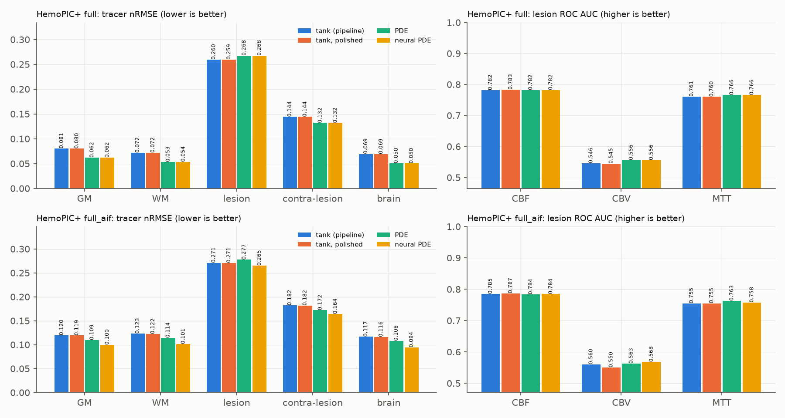
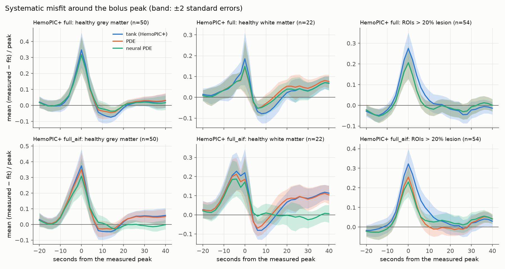
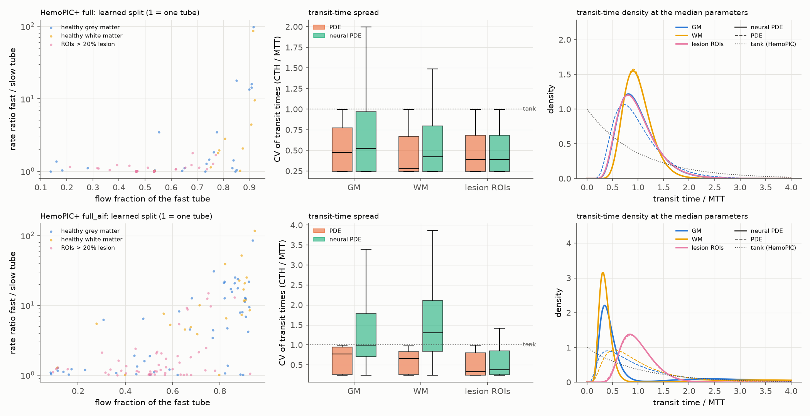
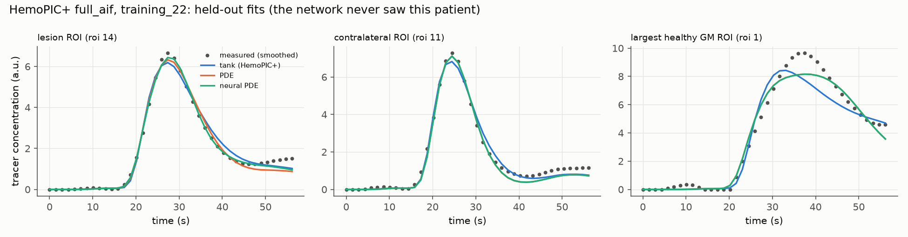

# HemoPIC+ — PDE vận chuyển và neural PDE

HemoPIC coi mỗi ROI là **một bể trộn đều** (một ngăn): thuốc vào bể là trộn đều ngay, nên phân bố thời gian đi qua mô là hàm mũ. Phần này thay bể bằng **một ống có dòng chảy và trộn dọc đường** (PDE vận chuyển–khuếch tán), rồi thêm một **mạng neural nhỏ, dùng chung cho cả cohort**, học cách mỗi ROI tách thành hai đường song song nhanh và chậm (neural PDE).

## 1. Vì sao cần

Lấy trung bình sai số (đo − fit) theo thời gian quanh đỉnh bolus trên 651 ROI của HemoPIC+ thì thấy một quy luật rõ, không phải nhiễu:

- mô hình **thấp hơn đỉnh đo 14–35% chiều cao đỉnh**, ở mọi nhóm (chất xám, chất trắng, tổn thương);
- ngay sau đỉnh, mô hình lại **cao hơn** số đo (−0.05 đến −0.08 của đỉnh, ở mô lành);
- với AIF tự động, phần đuôi bị thiếu (+0.05 đến +0.08).

Độ lệch gấp 5–16 lần sai số chuẩn. Nói đơn giản, bể trộn đều làm đường cong **tù hơn thực tế**. Điều này khớp với phần uncertainty: tham số dispersion của [C2] luôn dính cận dưới, tức dữ liệu muốn đường cong nhọn hơn mức bể trộn cho phép.

## 2. PDE vận chuyển

Mỗi ROI là một ống, s ∈ [0, 1] là phần thể tích máu đã đi qua:

  ∂c/∂t = k(t) · ( −∂c/∂s + (1/Pe) ∂²c/∂s² ),  k(t) = q(t) / (60 V)

- đầu vào (Danckwerts): c − (1/Pe) ∂c/∂s = (F/q) · c_in(t), với c_in là đường động mạch đã trễ và phân tán như [C2];
- đầu ra: ∂c/∂s = 0;
- đường cong mô: C(t) = ∫ c ds.

Tích phân theo s cho dC/dt = k (F/q · c_in − c(1)). Vậy **tracer được bảo toàn và thời gian đi qua trung bình đúng bằng 1/k**: CBF, CBV và MTT = 60 V / CBF giữ nguyên ý nghĩa (định lý thể tích trung tâm). Pe là tham số thứ 8 của mỗi ROI:

- Pe → 0: trộn đều, **đúng bằng HemoPIC+** (bể + bộ lọc đầu vào);
- Pe lớn: gần như đẩy thẳng (plug flow), đường cong nhọn hơn.

Vì PDE chứa HemoPIC+ như một trường hợp đặc biệt, fit bằng PDE (có một điểm xuất phát tại Pe = 0.02) không bao giờ tệ hơn HemoPIC+ trên từng ROI.

**Giải số.** 24 ô thể tích hữu hạn (đối lưu upwind, khuếch tán trung tâm). Trong mỗi frame, k và c_in được giữ cố định như `tracer_update` của HemoPIC, và hệ tuyến tính được giải **chính xác**. Toán tử là ma trận ba đường chéo, đồng dạng với một ma trận đối xứng, nên đường cong là tổng của 24 mode mũ: chỉ cần một phép phân rã trị riêng cho mỗi ROI, thay cho một phép mũ ma trận ở mỗi frame (nhanh hơn khoảng 10 lần). Cận Pe ≤ 100. Với 24 ô, độ khuếch tán số đặt sàn cho CV của thời gian đi qua ở khoảng 0.25.

**Kiểm tra tự động** (`tests/test_npde.py`):
1. 1 ô (mọi Pe) khớp HemoPIC+ tới 1e−16;
2. Pe → 0 khớp HemoPIC+ tới 1e−6;
3. với đầu vào hằng, mọi biến thể (một ống, nhiều đường song song, thể tích và độ trộn không đều) đều đầy tới cùng một trạng thái cân bằng (bảo toàn khối lượng);
4. lời giải dạng mode khớp lời giải bằng mũ ma trận tới 1e−9;
5. phân bố thời gian đi qua của mọi biến thể có tích phân 1 và trung bình 1 (theo đơn vị MTT).

## 3. Neural PDE: độ không đồng nhất của thời gian đi qua

Một ống chỉ làm phân bố thời gian đi qua **hẹp hơn** bể trộn (hệ số biến thiên CV từ 1 xuống khoảng 0.25). ROI chứa cả mô nhanh lẫn mô chậm, ví dụ một phần tổn thương nằm trong ROI lành, lại cần phân bố **rộng hơn**. Trong sinh lý học, đó chính là độ không đồng nhất của thời gian đi qua mao mạch (CTH, Østergaard), một chỉ số đáng chú ý trong đột quỵ.

Lý thuyết pha loãng chỉ thị yêu cầu động học tracer **tuyến tính** và **bảo toàn khối lượng**. Trong hai ràng buộc đó, phần mạng neural được học là: ROI tách thành **hai ống song song** cùng nhận một nồng độ đầu vào, với phần thể tích (ν, 1 − ν) và phần dòng chảy (φ, 1 − φ). Ống m chạy với tốc độ k · φ_m / ν_m, đường cong mô là Σ ν_m C_m. Dù chia thế nào thì thời gian đi qua trung bình vẫn là Σ φ_m · (ν_m / φ_m) / k = 1/k, nên **CBF, CBV, MTT vẫn đúng nghĩa vật lý; mạng chỉ đổi được hình dạng phân bố thời gian đi qua**, không "nuốt" được phần vật lý.

Một đường cong không đủ để xác định (ν, φ) cùng với 8 tham số vật lý (phần uncertainty đã cho thấy R và dispersion còn không xác định được). Vì vậy (ν, φ) do **một mạng MLP nhỏ dùng chung cho mọi ROI của mọi bệnh nhân** dự đoán (2 lớp ẩn × 32, khoảng 1.4 nghìn tham số), từ các đặc trưng **không dùng nhãn tổn thương hay bản đồ tham chiếu**: loại mô, prior F và V từ tracer, log(V/F), thời gian tới đỉnh và độ rộng nửa đỉnh của đường cong so với đường động mạch.

**Huấn luyện và đánh giá.** Kiểm tra chéo 5 phần **theo bệnh nhân**. Với mỗi phần:
- huấn luyện mạng cùng với tham số vật lý của các ROI thuộc bệnh nhân huấn luyện (Adam, 1500 bước);
- trên bệnh nhân bị giữ lại, **cố định mạng**, chỉ fit tham số vật lý của từng ROI (1000 bước);
- fit lại PDE thường trên đúng các bệnh nhân đó với **cùng bộ tối ưu và cùng số bước**, nên hai bên chỉ khác nhau ở phần mạng.

Mọi chỉ số của neural PDE vì vậy đều tính trên bệnh nhân mà mạng **chưa từng thấy**. Lúc khởi tạo, mạng gần như là PDE thường (hai ống tốc độ 1.13 và 0.87 lần trung bình). Lý do không khởi tạo đúng bằng hai ống giống hệt: đó là một điểm yên ngựa đối xứng, gradient theo cách chia bằng 0. Một phạt nhỏ trên logit(ν) − logit(φ) kéo hai tốc độ về gần nhau, trừ khi dữ liệu cần tách.

## 4. Kết quả

43 bệnh nhân, 651 ROI, hai cấu hình: `full` (đầu vào là đường trung bình của mô, không dùng AIF) và `full_aif` (AIF tự động). Chạy trên Windows (RTX 4090, 32 luồng, CPU), mất 17 phút cho cả hai cấu hình. Các mức so sánh:

- **tank (pipeline)**: HemoPIC+ như trong pipeline (Powell);
- **tank, polished**: cùng mô hình, đánh bóng thêm bằng L-BFGS-B. Đây là mốc công bằng, tách phần lợi do bộ tối ưu khỏi phần lợi do mô hình;
- **PDE**: ống vận chuyển (8 tham số, chứa HemoPIC+ khi Pe → 0);
- **neural PDE**: PDE + mạng dự đoán hai ống song song. Mọi số của neural PDE đều tính trên **bệnh nhân bị giữ lại**.



### 4.1 Bảng tổng hợp

| | nRMSE GM | nRMSE WM | nRMSE tổn thương | nRMSE đối bên | nRMSE toàn não | AUC CBF | AUC CBV | AUC MTT |
|---|---|---|---|---|---|---|---|---|
| **full**: tank (pipeline) | 0.081 | 0.072 | 0.260 | 0.144 | 0.069 | 0.782 | 0.546 | 0.761 |
| tank, polished | 0.080 | 0.072 | 0.259 | 0.144 | 0.069 | 0.783 | 0.545 | 0.760 |
| PDE | **0.062** | **0.053** | 0.268 | **0.132** | **0.050** | 0.782 | **0.556** | **0.766** |
| neural PDE (giữ lại) | **0.062** | 0.054 | 0.268 | **0.132** | **0.050** | 0.782 | **0.556** | **0.766** |
| **full_aif**: tank (pipeline) | 0.120 | 0.123 | 0.271 | 0.182 | 0.117 | 0.785 | 0.560 | 0.755 |
| tank, polished | 0.119 | 0.122 | 0.271 | 0.182 | 0.116 | 0.787 | 0.550 | 0.755 |
| PDE | 0.109 | 0.114 | 0.277 | 0.172 | 0.108 | 0.784 | 0.563 | **0.763** |
| neural PDE (giữ lại) | **0.100** | **0.101** | **0.265** | **0.164** | **0.094** | 0.784 | **0.568** | 0.758 |

Kiểm định cặp theo bệnh nhân (Wilcoxon, 43 bệnh nhân):

| | Δ nRMSE toàn não | Δ nRMSE tổn thương | Δ AUC CBF | Δ AUC CBV | Δ AUC MTT |
|---|---|---|---|---|---|
| full: PDE − tank polished | −0.019 (p = 5e−13) | +0.008 (p = 2e−6) | −0.001 (p = 0.06) | +0.011 (p = 6e−9) | +0.005 (p = 3e−5) |
| full: neural − PDE | −0.0002 (p = 0.10) | 0.000 | 0.000 | 0.000 | 0.000 |
| full_aif: PDE − tank polished | −0.008 (p = 2e−7) | +0.007 (p = 9e−5) | −0.003 (p = 6e−5) | +0.012 (p = 8e−8) | +0.008 (p = 1e−6) |
| full_aif: neural − PDE | −0.014 (p = 8e−9) | −0.012 (p = 9e−6) | +0.001 (p = 0.08) | +0.005 (p = 0.004) | −0.005 (p = 0.009) |
| full_aif: neural − tank polished | −0.022 (p = 7e−13) | −0.006 (p = 0.18) | −0.003 (p = 0.09) | **+0.018 (p = 6e−8)** | +0.003 (p = 0.55) |

### 4.2 PDE thường

- **Fit tốt hơn rõ rệt ở mô lành.** Sai số theo ROI giảm 34% (trung vị) với `full`, nRMSE toàn não 0.069 → 0.050. Với `full_aif`, mức giảm nhỏ hơn: 0.116 → 0.108.
- **Dữ liệu muốn đường cong nhọn.** Với `full`, Pe chạm cận trên ở 69% ROI. Lý do là đầu vào ở đây là đường trung bình của mô, vốn đã bị làm tù, nên ROI chỉ cần thêm rất ít độ phân tán. Với AIF thật (`full_aif`), Pe trung vị là 5.9 (CV thời gian đi qua khoảng 0.55), và chỉ 35% ROI chạm cận.
- **Tham số vật lý thay đổi có hệ thống.** So với bể trộn, MTT dài hơn (×1.34 với `full`, ×1.18 với `full_aif`), CBF thấp hơn 8–13%, CBV cao hơn 9–16%. Bể trộn cho thuốc bắt đầu ra khỏi mô ngay lập tức, nên phải dồn phần trễ vào tham số delay và đánh giá thấp MTT. Ví dụ ở chất xám bệnh nhân 22, MTT từ 2.9 s lên 4.0 s, gần với giá trị thường gặp trong DSC-MRI hơn.
- **AUC của CBV và MTT tăng nhẹ nhưng có ý nghĩa** (+0.011/+0.012 và +0.005/+0.008). CBF không đổi.
- **nRMSE vùng tổn thương tăng nhẹ (+0.007/+0.008), dù trên từng ROI PDE luôn fit tốt hơn hoặc bằng bể trộn** (đã kiểm: hàm mục tiêu của PDE ≤ của tank trên mọi ROI). Chỉ số này so trung bình các đường cong ROI (theo phần trùng) với đường cong trung bình của riêng voxel tổn thương. Tổn thương thường chỉ chiếm một phần nhỏ của ROI, và phần đó đến muộn, kéo dài. Đường cong ROI càng tù (như bể trộn) thì lại càng "giống" voxel tổn thương một cách ngẫu nhiên. Đây là giới hạn của cách đo, không phải PDE fit kém hơn.

### 4.3 Neural PDE



- **Với `full`: không thêm gì.** Trên bệnh nhân bị giữ lại, neural PDE trùng với PDE thường (chênh lệch ≤ 2e−4, CBF/V/MTT không đổi). Đầu vào đã tù sẵn, nên mô hình chỉ cần thu hẹp phân bố thời gian đi qua, trong khi hai ống song song chỉ làm nó rộng ra. Mạng học ra rằng không nên tách, và điều đó đúng.
- **Với `full_aif`: cải thiện rõ trên bệnh nhân chưa từng thấy.** Sai số theo ROI (trung vị) 0.0445 → 0.0273, giảm ở cả 5 fold (giảm 15–49% tuỳ fold). nRMSE toàn não 0.108 → 0.094, chất trắng 0.114 → 0.101. **Vùng tổn thương cũng tốt hơn** (0.277 → 0.265), lần này còn tốt hơn cả bể trộn, vì hai ống làm được phân bố rộng mà một ống không làm được.
- **AUC CBV tốt nhất trong mọi biến thể** (0.568, +0.018 so với tank polished, p = 6e−8). AUC MTT giảm 0.005 so với PDE thường nhưng vẫn ngang bể trộn. AUC CBF không đổi.
- **Phần vật lý không bị mạng "nuốt".** So với PDE thường, CBF, V và MTT chỉ đổi 1.3%, 0.8% và 2.2% (trung vị). Điều này đúng như thiết kế: mạng chỉ đổi được hình dạng phân bố thời gian đi qua.
- Hình sai số trên cho thấy cụ thể: với `full_aif`, phần đuôi bị thiếu ở chất trắng (+0.1 của đỉnh) **biến mất** với neural PDE, và độ lệch tại đỉnh ở vùng tổn thương giảm từ 0.32 xuống 0.23. Với `full`, cả ba đường gần như trùng nhau sau đỉnh.



**Mạng học được gì (`full_aif`).** Ở mô lành, mạng tách mỗi ROI thành một **ống nhanh mang khoảng 85% dòng chảy** và một ống chậm hơn 10–30 lần, giữ phần đuôi. CV của thời gian đi qua (CTH/MTT) tăng từ 0.54 lên 0.77 ở chất xám và từ 0.57 lên 0.88 ở chất trắng. Mức này cùng cỡ với tỉ số CTH/MTT ≈ 1 thường được báo cáo cho mô lành. Ở ROI tổn thương, mạng gần như không tách (CV khoảng 0.4).

**Cần thận trọng khi diễn giải.** Ống chậm có thể là độ không đồng nhất mao mạch thật, nhưng cũng có thể đang "hấp thụ" những gì mô hình chưa có: tái tuần hoàn mà AIF tự động không bắt được, sai số hiệu chỉnh thể tích từng phần của AIF, hoặc thuốc thoát mạch. Muốn phân biệt cần phantom có đáp án, hoặc dữ liệu có CTH đo độc lập.



### 4.4 Phát hiện phụ: ROI fit hỏng âm thầm

Đếm trên kết quả pipeline: có **84 / 55 / 65 ROI** (baseline / full / full_aif, trên 651) được báo `success = True` nhưng sai số chuẩn hoá > 0.5, tức đường cong mô hình gần như bằng 0:
- ở HemoPIC gốc, V co về khoảng 0.001;
- ở HemoPIC+, prior F tính từ độ dốc cực đại ra gần 0 và cận [0.2, 5] × prior không cho F thoát ra.

PDE và neural PDE không sửa được những ROI này. Chúng nằm trong cả hai phía của mọi so chênh nên không làm lệch kết luận, nhưng nên thêm bước kiểm tra chất lượng ROI (ngưỡng trên sai số sau fit, nới cận F khi prior quá nhỏ).

## 5. Hạn chế và bước tiếp theo

- **Sàn độ phân tán số.** Với 24 ô, CV nhỏ nhất là khoảng 0.25. Ở `full`, Pe chạm cận trên ở 69% ROI, tức dữ liệu muốn đường cong còn nhọn hơn mức mô hình cho phép. Tăng số ô làm lời giải dạng mode kém ổn định ở Pe lớn; cần một sơ đồ bậc cao hơn hoặc lời giải giải tích của bài toán Danckwerts.
- **Chỉ số nRMSE vùng tổn thương không đo đúng cái được fit** (xem 4.2). Nên bổ sung chỉ số tính trên ROI chủ yếu là tổn thương, hoặc fit riêng phần tổn thương.
- **Chưa có uncertainty cho neural PDE.** Có thể làm ngay bằng cùng công cụ của `docs/UNCERTAINTY.md`: Laplace hoặc MCMC trên 8 tham số vật lý với mạng cố định, cộng ensemble 5 mạng của 5 fold cho phần bất định của mạng. Kiểm tra quan trọng nhất: khi sai số có hệ thống giảm, độ phủ của Check 1 (giấu frame, hiện chỉ đạt 84% ở mức 95%) có tiến về đúng mức không.
- **Ý nghĩa sinh lý của hai ống** cần kiểm chứng (xem 4.3).
- Neural PDE chỉ có ích khi đầu vào là AIF thật. Đây là thêm một lý do để dùng `full_aif` làm cấu hình chính.

## 5. Cách chạy

```bash
python tests/test_npde.py                                   # PDE chứa HemoPIC+, bảo toàn khối lượng, MTT
python scripts/run_pde.py configs/full.yaml --workers 8     # PDE thường (và HemoPIC+ được đánh bóng bằng L-BFGS-B)
python scripts/train_npde.py configs/full.yaml --folds 5    # neural PDE, kiểm tra chéo theo bệnh nhân
python scripts/make_npde_figures.py                         # docs/figures/npde_*.png
```

Đầu ra: `outputs/<config>__polish/`, `__pde/`, `__pdeadam/`, `__npde/`. Mỗi thư mục là một bộ fit đầy đủ (đường cong, bản đồ CBF/CBV/MTT), chấm điểm bằng đúng `evaluate_subject` như các cấu hình khác. Bản đồ của PDE và neural PDE là bản đồ đã fit được nhân lại theo từng ROI với mức CBF và V mới, giống cách làm trong `run_uq.py`.
